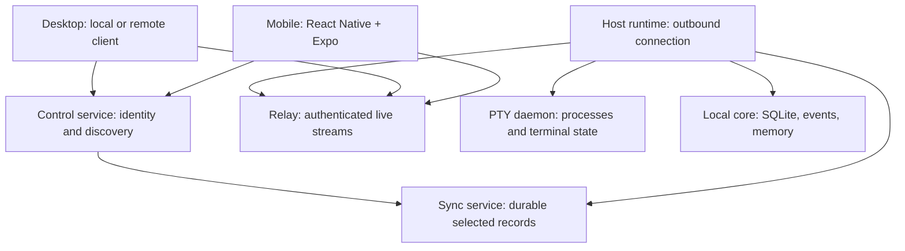

# Yardsort Remote, Mobile, and Sync

Status: implementation proposal and coding-agent handoff, not a claim of shipped functionality.
Date: 2026-10-21. Repository: https://github.com/joaoh82/yardsort
Audience: maintainers, contributors, and the coding harness implementing this work.

This document contains the specification, delivery plan, acceptance criteria, and a complete ready-to-paste kickoff prompt in section 18. It is self-contained; no access to the planning conversation is required. Suggested eventual home: `docs/design/remote-mobile-sync.md`, with a link from the design index. Choose a numbered filename only after inspecting the current index.

## 1. Outcome and settled decisions

Yardsort should let a person check and control their coding work from a phone or another computer, while keeping execution on a machine they own or operate. They should also be able to carry selected project information and approved memory between independent installations. A paid managed service should remove the operational burden of running the connection and sync infrastructure. Self-hosting must remain independently usable.

Settled product decisions:

- Desktop remains Tauri on Linux, macOS, and Windows.
- Mobile is React Native + TypeScript + Expo, for iOS and Android, using development builds and release app binaries. No PWA-first phase, Tauri mobile trial, or parallel Swift/Kotlin applications.
- The phone is a remote client. It does not run the coding harness, clone the execution worktree, or migrate a live process.
- Local desktop operation remains complete without a Yardsort account, subscription, or reachable server.
- Managed and self-hosted servers expose the same core protocol. Self-hosting includes user management and does not require a managed Yardsort identity.
- Remote access and durable sync are separate capabilities sharing identity, authorization, and resource identifiers.
- First deliver a complete mobile-to-existing-host workflow; then notifications and operational hardening, headless execution and desktop remote clients, and durable sync.
- Keep the project open source. Sell managed operation and convenience. Do not silently change licenses or impose a subscription on existing local features.

Implementation defaults in this proposal (subject to a documented fit adjustment, not silent redesign): Rust service code, PostgreSQL for server records, HTTPS/WSS transport, OIDC authorization-code flow with PKCE for interactive login, and a bundled xterm.js terminal inside an isolated React Native WebView. Framework selection is closed; terminal implementation details still require device validation.

## 2. Repository baseline and mandatory fit pass

The inspected local `origin/main` snapshot is `74df92c54a1a5561f1b7fcd71e90f027f570ef4c`, release v0.20.0. The live GitHub design index was also read on the document date and lists events/memory through stage 6, task and repository features, and the existing design series through 24. This is a baseline, not a guarantee that the implementation checkout is still identical. No repository files were changed or committed when preparing this handoff.

Observed foundations:

| Area | Existing foundation to preserve |
| --- | --- |
| Desktop | Rust core and SQLite own state; React/TS renders it through the existing IPC boundary |
| Terminal | Tauri frontend uses xterm.js; `crates/pty-host` owns PTYs and headless terminal state |
| Daemon | Same executable in daemon mode, local socket/named-pipe IPC; window-independent PTY lifetime |
| Attachment | Snapshot followed by live output; existing handling of terminal queries and Windows ConPTY |
| Events | Structured metadata beside opaque terminal bytes; canonical SQLite storage and bounded recovery mechanisms |
| Memory | Reviewed project notes; agents can propose, humans approve; `ys memory` and launch-context delivery |
| Jev | Optional downstream judgments, including duplicate/contradiction checks; not storage, authorization, or a text generator |
| Tasks | Existing forge-backed tasks and workspace references; do not invent a conflicting local task model |

Important corrections to older planning assumptions:

1. JSONL and SQLite are not two equal authoritative event stores. Current design selects SQLite as canonical, with optional NDJSON export and bounded recovery spools where needed. Do not introduce a permanent second event log for this feature.
2. The existing PTY daemon is not already a complete authenticated remote workspace server. Project state, launch services, credentials, and event ingestion need a deliberate host-runtime boundary.
3. Do not assume MCP memory delivery shipped. The reviewed-memory design uses `ys memory` and launch context.
4. The current memory design says sharing approved notes with local agents is enabled by default unless turned off, with per-launch exclusion. This is distinct from network sync, which requires explicit opt-in. Preserve the actual latest local behavior.
5. The inspected `package.json` declares `GPL-3.0-only`. Do not assume Yardsort is MIT from earlier discussion of another project. Verify repository license files and dependency obligations before distributing new artifacts; this spec does not relicense anything.

Before coding, inspect `AGENTS.md`, `CONTRIBUTING.md`, current design docs, migrations, tests, launch/resume/fork paths, daemon protocol, CLI, activity ingestion, memory approval, credentials, and current branches/PRs. Record HEAD, branch, dirty state, available upstream comparison, and changes since this baseline. Do not reset, merge, overwrite, or clean existing work to make this proposal fit.

Produce a fit report with: existing/reusable/missing components; corrected paths and symbols; overlapping in-flight work; state ownership; migration strategy; protocol compatibility; and the first bounded implementation slice. Public docs must use synthetic example names and paths, never personal repository paths or account details.

## 3. Product scenarios and scope

### 3.1 Existing computer, phone companion

The user starts Claude in a workspace on a laptop, later opens Yardsort on a phone, sees that workspace and its latest activity, attaches to the same running terminal, and replies. Codex in the same workspace is a separate session that can also be selected. Shared worktree access is not shared conversation history; existing memory/handoff features remain responsible for deliberate cross-harness context sharing.

When the phone locks, the process continues on the host. When the phone returns, it reconnects to the same session. If the computer sleeps or loses connectivity, the app says offline with a last-seen time. Remote access cannot make a sleeping computer execute commands.

### 3.2 Always-on host

The user runs a headless host on a server or in a container with persistent storage, then connects from mobile or desktop. This directly addresses issue #92: one execution location, multiple clients. A container alone is not a security boundary suitable for hostile unrelated users; initial execution hosts are single-user/trusted environments.

### 3.3 Independent computers with sync

The user works locally on Linux and later locally on macOS. Approved memory and selected project/workspace metadata synchronize. Each machine keeps its own checkout, OS paths, credentials, and processes. Getting source changes to the second machine uses Git and an explicit checkout flow, not database sync. A live Claude process and its native conversation do not move between machines.

### 3.4 First public mobile scope

Include server/account setup, paired host discovery, workspace/session lists, recent activity, terminal viewing and input, reconnection, explicit control ownership, notifications, and device revocation. Provide read-only approved-memory access when the host exposes it without inventing a new memory subsystem.

Exclude mobile code editing, Git push/merge actions, workspace deletion, new remote process launch, automatic approvals, background terminal recording in the cloud, team collaboration UI, general port forwarding, and provider-hosted compute. Add these only in separately scoped increments. Typing in a terminal already grants powerful execution capability; “no launch button” does not make terminal control low privilege.

## 4. Architecture and ownership



Arrows represent logical connectivity, not exclusive data direction. The relay carries bidirectional traffic over outbound host and client connections. Identity, relay, sync, and notification workers may initially be modules of one deployable service; no microservice fleet is required.

| Component | Owns | Must not own |
| --- | --- | --- |
| Host runtime | Workspace APIs, authorization enforcement, event subscriptions, local DB integration, connection lifecycle | A duplicate PTY implementation |
| PTY daemon | Child lifetime, I/O, screen snapshot, attach state, terminal-response coordination | Accounts, billing, synchronized memory conflict resolution |
| Relay | Connection routing, bounded buffers, connection limits | Persistent terminal transcripts or process truth |
| Control service | Accounts, device grants, host directory, short-lived connection tickets | Unrestricted commands executed on hosts |
| Sync service | Opted-in durable records, revisions, tombstones, cursors | Filesystem worktrees or running process state |
| Mobile | Views, ephemeral terminal buffer, explicit user intents, credential storage | Authoritative workspace or execution state |

Extract only the services necessary to run the host without the desktop window. Do not move all Tauri commands into a new network endpoint. Add an allowlisted remote facade over core services. The facade translates explicit requests and sanitizes responses; it does not expose environment variables, complete launch arguments, native harness logs, or arbitrary file reads.

Only one active host-runtime owner may serve a given local data directory. Define how desktop and headless startup discover or reuse it. Retain existing supported CLI/database access patterns; do not introduce conflicting migration owners or a second daemon for the same running PTYs.

## 5. Identity, pairing, and authorization

### 5.1 Server-scoped identity

A server has a stable identity and HTTPS base URL. An account identity is `(server_id, issuer, subject)`, not an email address. Managed and self-hosted identities are independent; matching emails never link them automatically. The mobile app may remember several server profiles but uses an explicit active profile, with completely separate credentials and caches.

Use OIDC with PKCE through the system browser for interactive sign-in, including state/nonce validation and exact redirect URI handling. Integrate an established OIDC provider rather than implementing password security in Yardsort. The self-host package documents a supported provider configuration and a reproducible local setup. Signup policy belongs to the chosen deployment: managed registration, or self-host invite/admin registration. Yardsort stores user/resource ownership separately from the identity provider.

### 5.2 Enrollment sequence

1. User explicitly enables Remote on a host and selects the server.
2. Host authenticates and obtains a device identity and restricted credential. Store secrets in the OS credential store, or a documented permission-restricted secret mount for headless operation.
3. Mobile signs into the same server/account and scans a host enrollment QR code or enters a one-time code.
4. Code exchange requests a grant; it does not immediately grant terminal access. The host shows the new device and requested access for explicit confirmation. Headless mode provides an equivalent explicit administrative confirmation.
5. After approval, issue a device grant with allowed host/projects and scopes. Never put long-lived credentials into QR codes, logs, URLs, or terminal launch environments.
6. Revoke a device from host or account settings. Terminate its existing streams and refresh capability checks; changing the UI alone is insufficient.

Proposed limits: enrollment expires after five minutes, manual-code attempts are rate-limited per code and source, codes are single-use and stored as hashes, and connection tickets expire after 60 seconds and are single-use. Use a high-entropy QR secret; a human code is only a lookup mechanism backed by rate limits and host confirmation.

### 5.3 Permission model

Initial UI is one owner with enrolled devices. Model scopes now: `workspace:read`, `activity:read`, `memory:read`, `terminal:read`, `terminal:control`, and `device:manage`. Project/host resource grants further constrain scopes. Defer team roles and invitation UX.

Every resource request checks server/account/device ownership and scope, including WebSocket attach and control acquisition. An opaque UUID is not authorization. The host independently checks its enrollment/grant binding. A terminal-control grant allows actions with the host user's OS privileges; explain this at enrollment.

Keep interactive device credentials out of agent environments and CLI-accessible settings. Remote memory approval is deferred; do not accidentally give an agent a new route to approve its own proposals. Same-OS-user isolation has limits: this is an application authorization boundary, not a sandbox against a malicious process with access to all user resources.

## 6. Transport and remote protocol

Use HTTPS for discovery/bootstrap and WSS for multiplexed session streams. Host opens an outbound connection to the selected relay, normally on port 443; no host router port forwarding is required. Direct LAN/mesh routing is a later optimization using the same authenticated protocol.

Version the remote protocol independently of desktop releases, local daemon IPC, and sync schema. Start with a single supported major, explicit capability negotiation, additive optional fields, and a machine-readable upgrade-required failure for incompatible peers. Never “try anyway” against an unknown major.

Logical API surface (names illustrative; finalize schemas in phase 1):

| Operation | Result / guard |
| --- | --- |
| `server.describe` | Server identity, protocol range, authentication issuer, feature availability |
| `host.list`, `host.describe` | Authorized hosts, connection status and last-seen time |
| `workspace.list`, `workspace.describe` | Safe metadata scoped to host/project; cursor pagination |
| `session.list`, `activity.list/subscribe` | Session/run identifiers and observed activity with provenance |
| `terminal.attach/detach` | Snapshot boundary and live stream; requires read scope |
| `terminal.acquire/release` | Control lease and generation; requires control scope |
| `terminal.input/resize` | Requires current lease and matching stream/session generation |
| `device.revoke` | Invalidates grants and live connections |
| `memory.list/search` | Approved notes only; respects existing project access policy |

Each control request carries request ID, operation, protocol version, scoped resource ID, and typed payload. Responses carry either a typed result or a stable error code, safe human message, and retryability flag. Define at least unauthenticated, forbidden, host-offline, session-ended, control-conflict, cursor-expired, rate-limited, protocol-incompatible, and invalid-request errors.

Use binary frames for terminal bytes, with stream ID, epoch, and monotonic sequence metadata. Final encoding is selected in phase 1; do not JSON-encode each terminal byte. Set payload/depth limits before decoding untrusted messages. Proposed initial bounds: 64 KiB control frames, 64 KiB output chunks, 1 MiB queued output per attached client, and explicit chunking/size limits for snapshots. Benchmark and document any adjusted values.

### 6.1 Snapshot and reconnection correctness

An attachment returns a snapshot at a specific output sequence and then output strictly after that sequence. Generate the snapshot/stream boundary atomically inside existing terminal ownership. A lost race here corrupts full-screen TUIs even if plain text appears fine.

Sequence numbers are scoped to a terminal stream epoch. On a short disconnect, resume from a retained cursor when possible. If the epoch changes or the replay window is unavailable, issue a fresh snapshot and replace the view; never append it to an old screen. Activity subscriptions use their own cursor and refresh authoritative lists after gaps.

Slow clients must not block PTY readers or other clients. If the bounded client queue overflows, detach that client with a resnapshot-required error. Do not silently drop bytes and continue rendering a corrupt terminal. Relay failure disconnects remote viewers but must not stop local processes or local desktop input.

### 6.2 Input and multiple viewers

Many clients can view; exactly one controls input and PTY dimensions at a time. Integrate this arbitration across local desktop and remote attachments, not only between phones. A viewer does not resize the process. In view-only mode render at host dimensions with horizontal scrolling when necessary.

Control acquisition is explicit. Show who currently controls the terminal. The local user can reclaim control immediately, invalidating the prior lease generation. Proposed lease: 30 seconds, renewed every 10 seconds; suspension/disconnect stops renewal. Reject stale input and resize frames, even if they arrive over a still-open socket.

Input carries a monotonically increasing sequence within a control lease. Deduplicate within the active lease and preserve ordering. On ambiguous delivery, show that input delivery is uncertain; never automatically replay queued typing or destructive commands after reconnection. Do not claim exactly-once execution across process/host crashes. Clear unsent terminal input on lease loss.

Terminal query responses must have a single designated responder. Preserve existing host/xterm/ConPTY behavior; additional viewers must not send duplicate cursor reports or device responses. Treat this as a release gate, especially on Windows.

## 7. Mobile application specification

Proposed repository layout, adjusted only after the fit pass:

- `apps/mobile/`: Expo application and mobile-specific screens.
- `packages/remote-client/`: platform-independent TypeScript protocol client.
- `packages/remote-contracts/`: generated or schema-derived DTOs and validation.
- `packages/terminal-view/`: bundled web terminal assets if extraction is justified.
- Rust crates/modules for remote protocol, host facade, and server as consistent with the existing workspace.

Do not reorganize the entire repository or move the desktop app just to adopt this layout. Reuse the established package manager unless Expo compatibility requires an explained isolated exception. Pin a currently supported Expo SDK and its compatible React Native/React versions at implementation time; do not force mobile to match desktop React versions.

Use Expo Router for navigation, SecureStore for mobile credentials, and development builds for native modules. EAS is optional build infrastructure, not a runtime requirement. Maintain documented local build routes; iOS compilation/signing requires an appropriate macOS/Xcode environment. Do not pretend a Linux-only validation run proves iOS readiness.

Screens:

1. **Connect:** managed service or custom HTTPS server; explain account scope and server trust. QR pairing plus manual fallback. Do not silently switch credentials to a new server discovered in a link.
2. **Hosts:** online/offline/reconnecting, last seen, device name; host detail lists projects/workspaces.
3. **Workspace:** branch, harness sessions, latest activity, and approved memory when available. Distinguish live data from cached observations.
4. **Session:** terminal, observed activity, view/control mode, reconnect state, special-key toolbar, and explicit control acquisition.
5. **Settings:** server profiles, paired devices/revocation, notification permissions/preferences, data cache clearing, diagnostics.

Build native mobile layout rather than attempting to render desktop DOM components. Share pure logic, not Tauri imports or desktop stores coupled to IPC. Support safe areas, screen readers, dynamic text in native screens, portrait/landscape, external keyboards, and accessible labels on terminal controls. Tablet layouts are responsive enhancements, not a separate product.

### 7.1 Terminal renderer

Default: `react-native-webview` containing bundled, pinned xterm.js assets. React Native owns connection credentials and network transport. The embedded page receives only display data and restricted typed bridge messages; it never receives account refresh tokens. Disable arbitrary navigation, injected remote scripts, and automatic clipboard writes from terminal escape sequences. Open links only through an explicit user action and allowlisted URL schemes. Validate and bound every bridge message.

Prototype this component early within the chosen React Native stack. Test IME composition, Unicode, multiline paste, bracketed paste, selection, keyboard viewport changes, Ctrl/Esc/arrows, and full-screen agent TUIs. Do not parse terminal text to infer approvals. Hardware results may change renderer/bridge choices, not reopen the framework comparison.

### 7.2 Offline and lifecycle behavior

No perpetual background socket assumption. Suspend stream work when appropriate; reconnect and refresh on foreground. Cache only minimal workspace metadata by default, scoped to server/account, with observation timestamps. Do not persist terminal transcripts by default. Clear credentials and account caches on logout; do not display prior-user content after account switching.

No offline terminal commands. An offline host shows last-known state explicitly. Loss of phone connectivity does not mean the agent failed. A terminated host process requires normal harness resume behavior; remote reconnection cannot resurrect it.

## 8. Notifications and harness semantics

Use structured events where available. Separate `running`, PTY `quiet`, explicit harness `awaiting_input`, completed, and failed. If no structured awaiting-input event exists, use a clearly labeled quiet/activity notification or omit that signal. Do not turn silence into a permission request.

Flow: host emits a bounded notification intent; service deduplicates and applies preferences; push provider delivers a generic alert; user opens the app; app authenticates and fetches current state. Push is advisory and may be delayed or duplicated. A tap must not approve or execute anything by itself. Key notifications by event identity and coalesce noisy activity.

Use `expo-notifications` with a server-side provider abstraction. APNs/FCM can be used directly; Expo Push Service is optional. Default lock-screen text is generic and excludes terminal content, prompts, memory, code, secrets, and project names. Richer previews require explicit user choice.

Self-hosting distinction: ordinary self-host operators cannot send push for the official app using the publisher's private signing/provider credentials. Offer either (a) optional Yardsort-operated push gateway with opaque routing IDs and generic payloads, or (b) a documented independently built app with its own identifiers and push credentials. Fully self-hosted remote access must work without that gateway; clearly state when background push is unavailable. Keep gateway opt-in separate from relay selection.

## 9. Security, trust, privacy, and lifecycle

This proposal's v1 transport baseline is TLS on both client-to-service and host-to-service connections. The relay is a trusted endpoint and can technically inspect forwarded payloads. Do not advertise end-to-end encryption or a zero-knowledge service. Display this trust model before enabling Remote. If provider-blind transport becomes a requirement, add a reviewed end-to-end protocol before public release; do not invent cryptography during implementation.

Remote access is off until enabled. Sync is separately opted in per project. Do not infer network permission from existing local memory-sharing settings. Denying access or a billing failure never terminates local agents.

Required controls: tenant scoping on every query and stream; short-lived tickets; refresh-token rotation where supported; rate limits; device revocation; connection quotas; TLS validation without a production “ignore certificate” switch; secure secret storage; no tokens in URL query logs; no plaintext terminal payload logging; bounded queues and parsers; sanitized errors; and tests for cross-account resource IDs.

Minimize telemetry. Audit enrollment, login-related security events, control acquisition/release, revocation, and sync mutations using identifiers and outcomes, not terminal input/output. Proposed audit retention is 30 days, configurable for self-hosting. Relay buffers are memory-only and discarded on disconnect. Presence is ephemeral; persisted last-seen data must be marked historical. Notification retries have a short expiry and must not deliver stale “waiting” claims as current truth.

Server deletion/export flows must cover account records, grants, push routes, synchronized records, and retained audit policy. Document backup expiry separately from immediate deletion; a restored backup must not reauthorize revoked devices without reconciliation. Removing a server profile locally is not deletion of its server-side account. Revocation cannot erase data a device already received.

## 10. Sync specification

Sync follows the usable remote feature. A server's durable data and a host's live runtime remain distinct even when deployed on the same machine.

### 10.1 Data boundary

| Record | v1 sync behavior |
| --- | --- |
| Project identity and display metadata | Explicitly linked across installations; never merge solely by repository URL |
| Workspace logical metadata | Sync name, branch/reference, task links, ownership, archive state; show host/checkout mapping |
| Approved memory | Sync text, approval provenance, revisions, source references, and revocations |
| Candidate/rejected memory | Local in initial sync; do not accidentally promote or upload |
| Device paths and checkout mapping | Local binding; exclude private absolute paths from synced records |
| Running sessions | Host-owned live state; optional last-observed summaries are labeled historical |
| Raw telemetry, transcripts, native harness history | Excluded by default |
| Git objects/uncommitted changes, credentials, environment | Excluded |
| Memory-sharing preferences | Keep local unless an explicit future policy says otherwise |

Use stable globally unique logical IDs alongside existing local IDs if necessary. Each checkout maps a logical project/workspace ID to a host-local path. An existing clone can be explicitly linked; the user must resolve ambiguous forks/remotes. A synced workspace does not automatically create a worktree. An explicit materialization action uses Git, validates branch state, and refuses to overwrite conflicting local work.

### 10.2 Storage and replication

SQLite remains authoritative for local operation. PostgreSQL stores server users, grants, synced records, revisions, change log, idempotency records, and cursors. JSONL may be an export format; do not synchronize SQLite files, database WALs, or a permanent JSONL event log.

On an opted-in local mutation, write an outbox entry in the same transaction as the local change. Agent phase 0 must identify all mutation routes, including desktop and CLI, so none bypass sync recording. Every operation has `op_id`, source device, resource ID/type, base server revision, schema version, and payload. The server transaction checks authorization, deduplicates `op_id`, validates the base revision, writes the new record, and appends a change cursor atomically.

Clients push bounded batches, then pull changes after their cursor. Apply a pull batch and advance its cursor in one local transaction; imported changes must not create an echo outbox. Use exponential retry with jitter for transient errors; invalid/conflicting operations enter a visible resolution state rather than retry forever. Clock timestamps are for display, not conflict authority.

Initial sync of existing approved notes requires a preview of the project and upload scope. A new device downloads a consistent snapshot plus change cursor before incremental pull. Preserve pending local changes during full resync. Server switch/migration is an explicit export/import or relinking operation, never background cross-server forwarding.

### 10.3 Conflict and deletion rules

- Use optimistic concurrency for mutable records. Matching base revision applies; mismatched base produces an explicit conflict with both versions.
- Never silently choose one conflicting memory text by wall-clock last-write-wins. Preserve both for human resolution; keep the last uncontested approved revision or suppress injection if revocation is involved.
- Revocation/deletion wins over a concurrent stale edit for injection eligibility. Restoration requires an explicit new action against the latest revision. Out-of-date clients must not resurrect revoked notes.
- Workspace metadata conflicts do not rename branches, delete directories, or terminate sessions automatically.
- Keep tombstones/change history for an initial 90-day recovery window. A client older than the retention floor must obtain a new snapshot. Retain resource revision/deletion markers sufficient to reject stale creates/updates; stale pending edits become conflicts, never silent resurrection.
- Deduplicate operations for at least the supported offline retry window. Reject unknown-base operations after that window and require reconciliation.
- Offline devices may continue using previously approved local notes until they reconnect. State this limitation: revocation cannot propagate instantly to an offline client. After pull, revoked text disappears from future injection/search; already-running agent context cannot be recalled.

Preserve existing source attribution even when a referenced session/event exists only on the origin machine. Show “source unavailable on this device”; do not fabricate a globally available citation.

## 11. Headless execution and desktop remote mode

Extract a supported host executable or headless entry point that initializes required core services without a WebView, discovers/reuses the PTY daemon, ingests events, serves the remote facade, and reconnects outbound. Inspect the current same-binary daemon design before choosing packaging. Do not expose its trusted local socket directly to the internet.

Linux server/container distribution is the first headless deployment target. Desktop-host remote access must still work on Linux, macOS, and Windows. Mount persistent repositories, worktrees, state, and explicitly supplied credentials; run as a non-root user; document UID permissions, backup, upgrades, and shutdown. Do not mount the Docker socket or distribute user harness credentials in an image. Harness installation and licensing remain explicit operator responsibilities.

Account service and execution host are separate roles. A multi-tenant managed relay does not imply multi-tenant agent execution. Managed cloud compute is out of scope.

The desktop remote adapter uses the same remote facade and shows the selected host prominently. Local paths cannot be opened as if they existed on the viewing machine. Remote file browsing, editing, Git writes, and new session launch require their own scoped API increments and are not enabled by exposing all local commands.

## 12. Managed service and self-hosting

Ship a reproducible self-host deployment with the server, PostgreSQL, supported identity-provider setup, TLS/reverse-proxy instructions, configuration example, health/readiness checks, backup/restore procedure, and upgrade instructions. Identity-provider and push-provider credentials stay server-side. No managed Yardsort account is needed to authenticate to this installation.

The managed offer operates the same core functionality: signup, stable service endpoint, relay capacity, device discovery, push convenience, durable sync, backups, and operational support. Pricing and exact quotas are later commercial decisions; measure relay bandwidth, concurrent streams, sync storage, and active devices to inform them.

Entitlements are checked on the server, never trusted from the client. Subscription changes affect future managed service access according to a documented grace period. They must not delete local work, terminate local agents, or prevent export of user-owned synced records. Do not implement mobile checkout until current store billing rules and the business model have been reviewed; this document chooses no payment provider.

Preserve the repository's current open-source license and notices. Public docs may cite Superset and issue #92 as product references without copying their code or proprietary material. No Beacon implementation dependency is needed here.

## 13. Delivery plan and exit gates

Each phase should be split into small reviewable changes with implementation, meaningful tests, user docs, and an accurate status record. Phase names are separate from the existing agent-events stages 0–7.

| Phase | Deliverable | Exit gate |
| --- | --- | --- |
| R0: Fit | Current-state report, ownership map, decision adjustments, dependency/license audit plan | Actual HEAD and code paths recorded; overlap resolved without overwriting user work |
| R1: Contract and host facade | Versioned DTOs, safe workspace/session reads, terminal attach/control contracts, local adapter tests | Existing local app/CLI behavior preserved; incompatible clients rejected; auth boundary documented |
| R2: Identity and relay | Server-scoped accounts, enrollment/revocation, outbound host connector, bounded relay | Two-account isolation tests pass; revoked device loses an active stream; relay failure leaves PTYs alive |
| R3: Mobile vertical slice | Expo app, pairing, host/workspace list, terminal view/control, reconnect | Physical iPhone and Android interact with real agent sessions on existing hosts; keyboard and control handoff pass |
| R4: Mobile beta hardening | Notifications, lifecycle behavior, privacy defaults, diagnostics, self-host setup | Lock/resume and network changes pass; generic push works; offline host state is honest; no payload leakage |
| R5: Headless and desktop remote | Supported Linux host package/container and desktop remote adapter | Same session usable from both clients; host works without GUI; persistent data survives service restart |
| R6: Durable sync | Explicit linking, outbox/inbox, approved-memory and metadata sync, conflict UI | Offline edits converge or surface conflicts; revocations do not resurrect; no files/processes silently migrate |
| R7: Managed launch | Signup operations, quotas, billing integration, recovery/export, support runbooks | Backup restore drill, load and isolation tests, deployment rollback, and store distribution gates complete |

R3 depends on R1/R2 for a real end-to-end path. UI mockups can precede that, but do not call mocked connectivity done. R4 may be tested privately while R5 develops. R6 requires stable identity and resource mapping but is not a prerequisite for mobile remote access. Managed beta can operate R2–R4 before commercial launch R7.

Suggested first coding session: R0 plus a bounded R1 slice that defines the remote read contract and adapts existing workspace/session data to it with tests. Do not attempt the complete roadmap in one execution. Each later session selects one exit gate and updates a progress ledger.

## 14. Verification and measurable budgets

These are proposed engineering targets, not measured current performance. Establish the test environment and revise explicitly if evidence warrants it.

- Workspace list p95 under 1 second with a warm connection and 100 workspaces at 100 ms RTT.
- Terminal input-to-visible-echo p95 under 300 ms at 100 ms RTT for an interactive echo workload; separate harness processing time from transport latency.
- Foreground reconnection to a reachable host and usable screen within 5 seconds under normal network conditions.
- Bound per-viewer queues; a stalled viewer must not increase another viewer's latency without limit or block local input.
- Pairing and revocation enforcement: a connected revoked device is disconnected within 5 seconds; new operations fail immediately after the authorization change is observed.
- A 30-minute mixed terminal workload shows no unbounded client/relay memory growth; background app behavior uses push/reconnect rather than constant polling.

Required automated and integration coverage:

1. Cross-account and cross-project request denial, invalid/expired/replayed pairing codes and tickets, revoked live connections, malformed/oversized frames, and protocol mismatch.
2. Real PTY sessions and full-screen redraw fixtures: atomic snapshot boundary, exit while detached, output gaps, duplicate frames, slow client, host/relay restart, simultaneous viewers, stale lease input, and single query responder.
3. Desktop and CLI local regressions: launching, resuming, forking, closing the window, existing event ingestion and memory behavior. Do not touch live user data in tests.
4. Mobile bridge origin/message validation, credential isolation, logout/account switching, denied notification/camera permissions, offline rendering, and stale deep links.
5. Sync using real temporary databases: duplicate push, interrupted transactions, cursor expiry, two-device conflicts, deletion versus stale edit, restore/import, authorization changes, outbox exhaustion, and migration upgrade.
6. Backup restore and server upgrade tests, including rejecting stale grants and preventing resurrection of deleted records.

Device/platform release matrix: iPhone and Android with software and external keyboards; desktop hosts on Linux, macOS, Windows; headless Linux; Claude and Codex real sessions plus a shell/TUI fixture. Test Unicode and IME, multiline paste, portrait/landscape, Wi-Fi/cellular transitions, phone lock/force-stop, host sleep/wake, and expired login. Add other supported harness smoke tests without claiming untested semantics.

Run repository-required checks from current `AGENTS.md`, including `just check`, `just bindings-check`, and relevant platform checks where still defined. Report checks not run and why. Do not manufacture passing mobile/device coverage from emulator screenshots or TypeScript compilation.

## 15. Operations, documentation, and rollout

Start behind an explicit Remote feature setting. Enabling/disabling remote connectivity should attach/detach the connector without killing running PTYs. If a necessary daemon upgrade cannot preserve sessions, detect that and require a clearly explained user action; do not restart it invisibly.

Release contracts and service/client version support together. Publish migration notes before dropping protocol support. Remote or sync outage must degrade to local-only operation. Sync errors retain pending outbox items within a documented bound and show remediation; never block terminal input while attempting network delivery.

Operational metrics: active hosts/streams, connection and reconnect latency, auth failures, rate limits, relay buffer pressure, sync lag/conflicts, push outcomes, and queue depth. Use aggregate values and pseudonymous IDs; no terminal content, command text, memory text, or repository paths in metrics.

Update guides for remote setup, mobile pairing, self-hosting, headless execution, sync scope/conflicts, privacy/trust, troubleshooting, and device revocation as each feature ships. Update design index, roadmap, changelog, CLI docs when applicable, and website navigation/claims according to repository instructions. Provide a support export with explicit redaction and preview.

Public launch requires tested installation/signing/update paths, store assets, accessibility review, privacy disclosures reflecting actual collected data, an account deletion route where applicable, and reproducible source/build instructions. Store submission, paid services, and production deployment require separate owner authorization; they are not authorized by this implementation document.

## 16. Decisions to resolve at the appropriate gate

The coding agent may select ordinary libraries and module locations after checking compatibility. Record significant changes as short ADRs. These are not reasons to reopen React Native versus Tauri mobile.

| Decision | Default / boundary | Resolve by |
| --- | --- | --- |
| Identity provider | Standards-based OIDC; supported self-host recipe; no bespoke password database | R2 |
| Server runtime packaging | Rust modules/services and PostgreSQL; reuse compatible project conventions | R1–R2 |
| Terminal bridge implementation | Bundled xterm.js in isolated WebView with native transport | R3 device gate |
| Relay confidentiality | Trusted TLS relay, clearly disclosed; no E2EE claim | Before public beta |
| Official-app self-host push | Optional publisher gateway; independent app build alternative | R4 |
| Headless daemon packaging | Reuse existing PTY ownership, extract only necessary host runtime | R5 |
| Sync record mapping/migrations | Preserve current domain IDs; explicit logical mappings if needed | R1 identifiers, R6 migrations |
| Billing, quota amounts, domains, app identifiers | Owner-supplied production choices; no invented credentials or paid provisioning | R7 |

If implementation evidence reveals a conflict with a settled product requirement, document it and ask a focused question. Missing production credentials should not prevent local development and tests with clearly identified fixtures.

## 17. References and interpretation

Read current repository sources before treating historical proposals as implemented truth:

- [Design index](https://github.com/joaoh82/yardsort/blob/main/docs/design/README.md)
- [Architecture](https://github.com/joaoh82/yardsort/blob/main/docs/design/03-architecture.md)
- [Events and memory](https://github.com/joaoh82/yardsort/blob/main/docs/design/09-agent-events-and-memory.md)
- [Stage 1 fit report](https://github.com/joaoh82/yardsort/blob/main/docs/design/10-agent-events-stage-1.md)
- [Reviewed memory](https://github.com/joaoh82/yardsort/blob/main/docs/design/19-agent-events-stage-5-memory.md)
- [Tasks](https://github.com/joaoh82/yardsort/blob/main/docs/design/23-tasks.md)
- [Issue #92: centralized execution with distributed clients](https://github.com/joaoh82/yardsort/issues/92). Motivates the headless-host and multiple-client scenario; it is not equivalent to replication between independent local workspaces.
- [Superset remote access](https://docs.superset.sh/remote-access). Product reference for connecting mobile clients to an existing execution host via a relay; no code reuse is prescribed.
- [React Native native components](https://reactnative.dev/docs/intro-react-native-components)
- [Expo development builds](https://docs.expo.dev/develop/development-builds/introduction/). Supports the selected installed-app development workflow.
- [Expo direct APNs/FCM delivery](https://docs.expo.dev/push-notifications/sending-notifications-custom/). Supports a provider-independent notification design.

Repository observations are tied to the baseline in section 2. All future APIs, layouts, limits, phases, and service choices above are proposed requirements/defaults, not claims that those capabilities currently exist.

## 18. Ready-to-paste kickoff prompt

Copy the entire fenced block below into your coding harness and attach this Markdown file. If placing the document in the repository first, use its actual path in place of the filename below. This prompt authorizes local implementation of the bounded first slice, not commits, pushes, paid provisioning, deployment, or store submission.

```text
You are working in the open-source Yardsort repository:
https://github.com/joaoh82/yardsort

Read the attached docs/design/Yardsort-Remote-Mobile-Sync-Spec-2026-10-21.md in full,
including its acceptance criteria and implementation phases. Treat it as a
proposal to reconcile with the current repository, not proof that its snapshot
or assumed module boundaries are still current.

Goal: implement remote workspace access and an installed React Native + Expo
mobile companion, followed by headless/desktop remote support and durable
cross-device sync. Desktop stays Tauri. Local operation stays account-free.
Managed and self-hosted servers use the same core protocol; self-hosting has
independent user management. Do not build a PWA or trial Tauri mobile.

First perform phase R0:
1. Read AGENTS.md and applicable nested instructions, CONTRIBUTING.md, current
   architecture, roadmap, agent-events, memory, task, and repository designs.
2. Record branch, HEAD, working-tree changes, and upstream comparison. Inspect
   recent commits and relevant open PRs where access permits. If you cannot
   inspect upstream, say so; do not call cached refs the latest version.
3. Trace actual app/CLI launch, resume/fork, daemon lifetime, PTY snapshot and
   stream ordering, terminal query responses, event ingestion, SQLite writes,
   memory approval/injection, credentials, and UI transport boundaries.
4. Search for remote, auth, relay, headless, mobile, and sync work already present.
   Reuse and extend it; do not create parallel systems or overwrite user changes.
5. Write a concise fit report in an appropriate docs/design path, with exact
   code references, baseline drift, ownership boundaries, migration/protocol
   compatibility, and a bounded first implementation slice. Link this spec in
   the design index if it is not already present. Preserve all unrelated work.

Then implement R1's first bounded slice: versioned remote read contracts and a
safe host facade over existing workspace/session state, with targeted tests.
Include the planned terminal attachment/control schema if needed to make the
protocol coherent, but do not expose an unauthenticated network listener or
claim remote terminal control is complete before auth and lease enforcement.
Use the repository's actual structure; proposed new paths are suggestions.
Do not perform a broad repository reorganization.

Important invariants:
- PTYs and their terminal output remain opaque; never infer permissions or
  approvals by parsing rendered output.
- Local processes must survive remote disconnect, relay failure, and phone
  suspension. Reuse the existing PTY host; do not build a second one.
- SQLite remains canonical locally. JSONL is not a second permanent event store.
  Future sync uses application records/outbox/cursors, not database-file copying.
- Existing memory review and delivery behavior remains intact. Do not assume
  MCP exists. Do not let agents approve their own memory through new APIs.
- Separate server identity, user identity, device grants, host identity, logical
  project/workspace identity, local paths, sessions, and process runs.
- Do not expose tokens, environments, full launch arguments, private paths, or
  raw transcripts in public schemas/logs without an explicit justified need.
- Many viewers, one input/resize controller, and one terminal-query responder.
  Reconnect must never blindly replay terminal commands.
- Preserve Linux, macOS, and Windows local behavior and append-only migrations.
- Keep the repository's current license and existing notices.

Use meaningful real-process/database tests where appropriate. Run focused
checks and the repository-required validation commands for the changed slice.
Report unavailable platforms and hardware honestly. Do not claim mobile device
validation from compilation or mocks.

Keep docs accurate in the same work: fit report, spec adjustments, progress
ledger, and any user-facing docs affected. Stop after this bounded R0/R1 slice
and report what changed, tests run, remaining risks, and the next phase/gate.
Do not mark the entire roadmap implemented.

Do not commit, push, open a PR, deploy, purchase/provision services, submit apps,
or send messages unless I explicitly authorize that separately. Local edits
and tests for this bounded slice are authorized. Make routine implementation
choices autonomously; ask only for decisions that materially conflict with the
settled product requirements or require missing external access.
```
