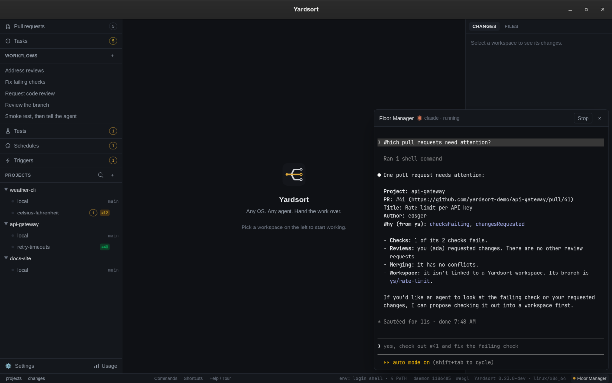

# Floor Manager

The Floor Manager is one agent with every project in view. Ask it what projects you have, what
the agents in them are doing, which pull requests nobody has reviewed, or which tasks are
waiting. Ask it to start work, and it suggests how. Whether it may then start that itself
is a setting: read only, ask first (the default), or trusted.

It is an ordinary agent in an ordinary terminal. You pick the agent: Claude Code, Codex,
OpenCode, or any other you have set up. It runs in a folder of its own rather than in a
project, and it is told how to use [`ys`](cli.md), Yardsort's command line, which sees exactly
what the window sees. Yardsort does not read what it prints, as with every agent.

_Floor Manager_ is a working name.

## Opening it

- **Floor Manager** at the right end of the bottom bar, in the lower-right corner of the window.
  A dot before the name means one is running.
- **Mod+J** (`Ctrl+Shift+J`, or `⌘J` on macOS). You can change it in
  [Keyboard shortcuts](shortcuts.md).
- **Mod+K**, then _Floor Manager_.

It opens as a panel over the lower-right corner. The rest of the window keeps working beside it.
**×** closes the panel, and so does the button or the shortcut again. **Closing it leaves the
agent running**, the same as closing the window does: it belongs to the
[daemon](terminals-and-sessions.md#agents-keep-working-when-you-close-the-window), and it is there
with what it said when you open the panel again.

## Starting it

The first time, the panel says what the Floor Manager is for and asks which agent to run it
with. Only agents that are switched on and installed are offered. Press **Start**. The choice is
remembered for next time.

There is only ever one. Opening the panel again shows the one that is running, whichever agent
it is.

The first time an agent runs in a new folder it may ask whether to trust it. Claude Code and
Codex both do. The folder is the Floor Manager's own (see [Where it lives](#where-it-lives)), so
saying yes is safe.

## What to ask

- _What projects do we have, and what is running in them?_
- _Which pull requests are open and not reviewed?_
- _Which pull requests need attention?_ That means failing checks, conflicts, changes requested,
  your review asked for, or no review at all.
- _Check the open pull requests and start reviewers on them._
- _What is waiting in the tasks for api-gateway?_
- _Start this task in yardsort: …. Is there a workflow for it?_
- _Change the code review so it runs the smoke tests first._

It answers from `ys`: `ys project list`, `ys session list`, `ys pr list`, `ys task list`,
`ys workflow list` and the rest. Pull requests and tasks are read from GitHub through your
[GitHub CLI](https://cli.github.com), so they need `gh` installed and logged in. With `gh`
missing, it says so.

## What it may do

**Floor Manager permission**, in [Settings → General](settings.md#general), chooses how much it
may do through `ys`. The choice is saved as soon as you make it. The next `ys` command follows
it; you do not restart the Floor Manager for that. The instructions file is rewritten when you
save, and one that is already running reads the new wording the next time it starts.

| Level         | What `ys` does                                                                                                                                                                                                                                                                              |
| ------------- | ------------------------------------------------------------------------------------------------------------------------------------------------------------------------------------------------------------------------------------------------------------------------------------------- |
| **Read only** | Looking works. A command that starts something or writes is refused, and nothing is created.                                                                                                                                                                                                |
| **Ask first** | The default. A start or a write waits until you press **Allow** in this window. **Don't allow**, and Escape, leave it unrun. The dialog appears even when the panel is closed. One Allow covers that command. If Yardsort is not open, or nobody answers within ten minutes, it is not run. |
| **Trusted**   | It may start agents, workspaces, workflows, tests, schedules, triggers and checkouts, and other writes that are not destructive, without asking.                                                                                                                                            |

`ys` enforces this. The launch sets `YARDSORT_COORDINATOR`, and while that is set `ys` reads the
level from settings and either refuses, waits for the button, or runs. An agent in auto mode
does not get to skip that: the window is what allows a start, not the agent's own prompt.

These `ys` commands are refused at every level, trusted included:

- `ys workspace delete`, with or without `--force`
- `ys task close`
- `ys attach`, which would put another agent's terminal on this one
- `ys workflow approve`, `ys workflow reject` and `ys workflow request-changes`, which
  decide an approval. Those are yours, in the app or in your own terminal.

There is no `ys` command for archiving a workspace, deleting a branch, merging, closing or
approving a pull request, or editing a project's files. The instructions say never to do those.
The gate cannot see them, because they are not `ys`. Commenting on a task, and the other
`ys task` writes, follow the level above. Closing one does not.

This is not a sandbox. The Floor Manager runs as you. A shell command that is not `ys` (`git`,
`gh`, an editor) is outside the gate, unless the agent's own permission prompts block it.
Unsetting `YARDSORT_COORDINATOR`, writing the answer file in the profile's
`coordinator/confirm` folder, editing `settings.toml` so the level is `trusted`, or pointing
`ys --data-dir` at a profile you made up, also gets around the permission check. Those are
the same kind of limit as any agent you start in a workspace. The harness's own prompts are
a second line, useful, and not the one this setting is.

An approval has a second check. `ys` refuses to decide when any of `YARDSORT_COORDINATOR`,
`YARDSORT_RUN_ID`, `YARDSORT_WORKSPACE_ID` or `YARDSORT_SESSION_RECORD_ID` is set, which a
session Yardsort started has. Dropping only the coordinator marker is not enough. A terminal
that is allowed still needs the one-time code shown in the app and in the notification.
Five wrong codes stop `ys` until the app shows a new one. A process running as you that
writes the database directly is not stopped.

The dialog does not run the command. It records yes or no, and the `ys` that is waiting is the
one that runs it.

### Changing a workflow

Ask it to change a [workflow](workflows.md), a built-in or one of yours: _make the code review
run the smoke tests first_. It reads the file with `ys workflow show`, writes the changed file
in its own folder, checks it with `ys workflow validate`, and saves it with `ys workflow save`.
It is told to change only what you asked and keep the workflow's `id`, so a changed built-in
becomes your copy, used instead of it. `save` refuses a file with problems.

Saving is a write. At ask first the confirmation shows the whole file that would be saved, and
the text you allowed is the text written, even if the file changes afterwards. The Floor Manager
must name a file: `ys workflow save -` is refused at ask first, because the confirmation could
not show what standard input holds. At read only it can show you the change and cannot save
it. A workflow open in the window shows the saved file within a second or two. If you had
unsaved changes in it, they stay as your draft, and **Revert** shows the saved file. It cannot
delete a workflow file through `ys`.

### Reviewing pull requests

For a pull request that a Yardsort workspace opened, the Floor Manager names the built-in
[code review](workflows.md#requesting-a-code-review) on that workspace.

For one somebody else opened, it names `ys pr checkout <number> --project <name>` first. That
makes a workspace on the pull request's branch, with no new branch and no agent. Then it names
the code review on that workspace. At ask first, which is the default, each of those waits for
**Allow**, and you can allow the first and not the second. At trusted it runs them. At read
only it can tell you the command and cannot run it. A reviewer starts there, reads and runs the
code without editing it, and posts its review on GitHub. You get a notification when it has.

A pull request from a fork gets a branch named `pr/<number>`. The built-in review finds a pull
request by its branch name, so it cannot review one of those yet. The Floor Manager says so.

### Workflows

Asked to start something, the Floor Manager reads `ys workflow list` and suggests a
[workflow](workflows.md) that fits, with the inputs it needs. If none fits, it suggests a plain
workspace instead.

### Running in the cloud

Yardsort does not run agents in the cloud. Everything the Floor Manager starts runs on this
computer, and it says so if you ask for a cloud run.

## Stopping it

**Stop**, in the panel's header, asks _End its conversation?_ first. **End it** stops it, and
**Keep it** leaves it running. You can also end it from inside, the way you would end that agent
anywhere, such as `/exit`.

When it has ended, by either way, the panel still shows its last screen and says _The Floor
Manager has ended._ **Start again** begins a **new** conversation. Picking up the old one is not
offered yet.

Closing Yardsort with the Floor Manager running asks the same question as with any agent that is
still working. It is listed there as _Floor Manager_.

## Where it lives

In a folder named `coordinator` inside your profile's data directory:

| OS      | Folder                                                       |
| ------- | ------------------------------------------------------------ |
| Linux   | `~/.local/share/dev.yardsort.app/coordinator`                |
| macOS   | `~/Library/Application Support/dev.yardsort.app/coordinator` |
| Windows | `%APPDATA%\dev.yardsort.app\coordinator`                     |

With `YARDSORT_DATA_DIR` set, it is `$YARDSORT_DATA_DIR/coordinator`.

At every start, and again when you change [Floor Manager permission](#what-it-may-do), Yardsort
writes two files there. `AGENTS.md` holds the instructions for the level that is set, which most
agents read. `CLAUDE.md` points Claude Code at them. **Both are replaced**, so an edit to them
does not last. Anything else you put in the folder is left alone.

The agent is started with:

- `YARDSORT_DATA_DIR` set to your profile, so `ys` reads the same projects the window shows;
- `YARDSORT_CONFIG_DIR` set to the folder that holds `settings.toml`. On Linux that is not the
  data directory. Yardsort removes a value set for it from every agent it launches, and from the
  terminal daemon, so a data directory an agent sets for itself keeps that profile's own settings;
- `YARDSORT_COORDINATOR` set, which is what makes `ys` enforce the permission. The value is
  ignored: the level is the setting, read on every command;
- the folder that holds this copy of Yardsort's own `ys` first on its `PATH`, so it uses the
  `ys` that matches the app, whether or not you [installed](cli.md#installing) one. A
  development build without `ys` built says so in the panel, and the agent then uses whichever
  `ys` it finds.

After Yardsort updates itself, **Start again** gives the Floor Manager the new instructions and
the new `ys`. The one already running keeps the instructions it has already read until it ends.
A permission you change still applies to its next `ys` command.
