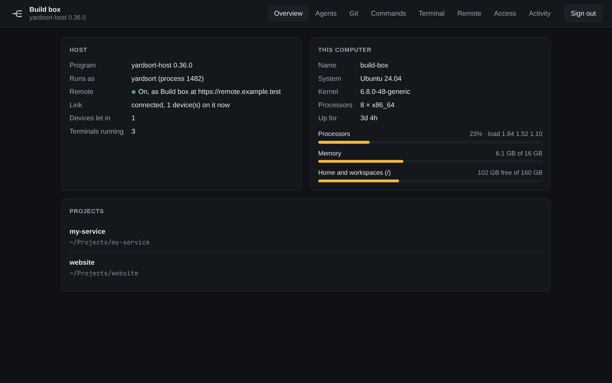
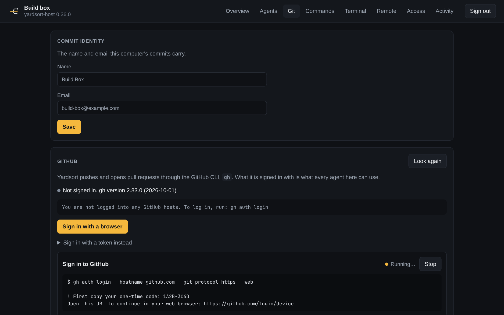
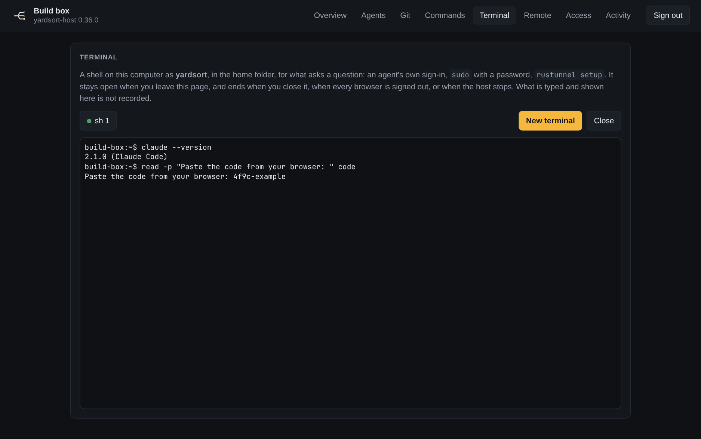
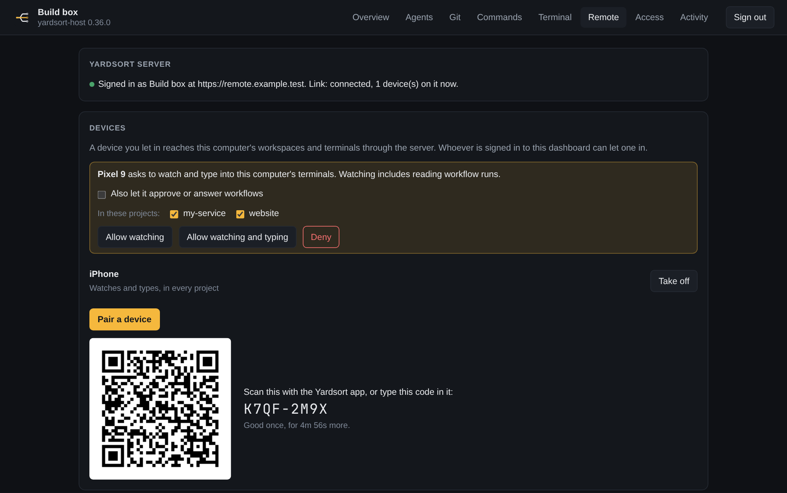

# The host dashboard

> **New in this release, and part of [Remote](remote.md), which is still under development.**
> Expect it to change.

The host dashboard is a web page a computer serves to itself, for looking after it as a host
from a browser: how it stands, the agents installed on it, Git and GitHub, the commands that set
it up, a terminal for what asks a question, signing it in to a Yardsort server and letting your
devices in. It is what you would otherwise do over SSH, a command at a time, after
[installing `yardsort-host`](headless-host.md#installing).



It is not another Yardsort. There are no workspaces, agents' terminals or conversations in it,
and it starts no agent: that is the [phone's and the desktop's](remote.md). It does not need
Remote either, so a server that is not signed in to anything yet serves it all the same, and is
signed in from it.

- **On a computer with no screen**, `yardsort-host serve` serves it unless you turn it off.
- **In the app**, it is off until you turn it on under **Settings → Remote → Host dashboard**.

## Who can reach it

**It listens on that computer alone**, on `127.0.0.1`, port 28680. Nothing on the network can
connect to it. From another computer you reach it one of two ways: a port forwarded over SSH, or
a [tunnel](#a-tunnel) you turn on.

**A browser must sign in**, with a one-time link that only that computer hands out, and only to
a person: at a terminal of your own there, or in the app's window. There is no password to
guess. A link is good once, for ten minutes; the browser then stays signed in for thirty days.

**Whoever signs in has a shell on that computer, as the user the host runs as.** That is what
it is for. Treat a sign-in link as you would treat an SSH login there.

**On a computer with no screen, whoever signs in can also let a device in**, and sign the
computer in to a Yardsort server: its [Remote](#remote) tab does both, so that a server can be
set up from a browser alone. Everywhere else in Yardsort a device is let in only by a person at
a terminal of their own or at the app's window. Here it is whoever holds a dashboard session, so
keep the dashboard's sign-in as close as you would keep pairing.

It approves no [memory](memory.md) note and turns no sync on: those stay at a terminal of your
own, or in the app. And only the page's own **Remote** tab pairs: `yardsort-host pair` typed
into **Commands** or into the page's **Terminal** is refused, as it is for an agent, so a
command you ran for another reason lets nobody in.

## Opening it on a computer with no screen

Log in to that computer over SSH, as the user that runs the host, and ask for a way in:

```sh
yardsort-host dashboard
```

```
Dashboard: http://127.0.0.1:28680
Tunnel: off

Sign a browser in, within 10 minutes, by opening:

  http://127.0.0.1:28680/#code=7K2M-9QXD-4TRA-B6WN

Or open the address alone and type the code: 7K2M-9QXD-4TRA-B6WN

From another computer, without a tunnel, forward the port first:
  ssh -L 28680:127.0.0.1:28680 <this computer>
```

That address is the server's own. To open it in the browser in front of you, forward the port
from your computer, in another terminal, and then open the link there:

```sh
ssh -L 28680:127.0.0.1:28680 build-box
```

`yardsort-host dashboard` is refused from any terminal Yardsort started, from anything an agent
runs, and from a script, as [`pair`](headless-host.md#only-a-person-can-pair-a-device) is, and
like `pair` it needs Linux. `yardsort-host status` says where the dashboard is and how many
browsers are signed in, and needs no terminal.

## Opening it from the app

Open **Settings**, then **Remote**, and under **Host dashboard** tick **Serve the host
dashboard**. The section then says where it is served.

- **Open the dashboard** opens it in this computer's browser, signed in.
- **Copy a sign-in link** puts a one-time link on the clipboard, for a browser elsewhere. It is
  this computer's own address unless the tunnel is up, so from another computer forward the port
  first, as above.
- **Sign every browser out** ends every session at once.

Unticking the box stops serving it, and it stays off the next time Yardsort starts.

## What is in it

### Overview

How the host stands: the program and its version, the user it runs as, whether Remote is on and
its link to the server, how many devices are let in, and how many terminals are running. Beside
it, the computer: its system, how busy its processors are, its memory, and how full the disks
under your home and your workspaces are. Below, the projects there.

### Agents

The agents Yardsort can start on that computer, as its login shell finds them: where each is and
its version, or that it is not there.

**Install** puts one into `~/.local`, as that user, and **Update** brings one up to date. It is
what [`yardsort-host install-agent`](headless-host.md#installing-an-agent) does: Claude Code,
Cursor's CLI and Grok come from each vendor's own installer, and the page names the vendor and
where their terms are, and asks, before it runs one; Codex CLI, OpenCode, Pi and Oh My Pi come
from npm. What the installer prints is shown as it runs. Installing is offered on Linux and
macOS.

**An agent still has to be signed in**, once, as its own guide says: open the dashboard's
[Terminal](#terminal), run the agent, and follow what it asks.

### Git



- **Commit identity**: the name and email that computer's commits carry.
- **GitHub**: whether the [GitHub CLI](https://cli.github.com) is signed in, in its own words.
  **Sign in with a browser** shows a one-time code and an address: open the address in any
  browser and type the code, and nothing has to open on the server. **Sign in with a token**
  hands that computer less than your whole account, as
  [Git and GitHub](headless-host.md#git-and-github) describes; the token goes straight to `gh`
  and is kept by `gh` alone. **Sign out here** signs `gh` out; the token is still good at GitHub
  until you delete it there.
- **Repositories**: give a repository's address and **Clone** clones it with that computer's own
  Git sign-in and adds it as a project. It goes into `~/Projects`, or the folder
  [`projects_dir`](headless-host.md#projects-and-agents) names.

### Commands

**Run a command** runs a line as that computer's shell would, from the home folder, as the user
the host runs as, and shows what it prints as it runs. **Stop** ends it, and everything it
started.

**Nothing is on a command's input.** One that asks a question gets no answer and fails, so pass
`-y`, or whatever the command has for that: `sudo -n apt-get install -y ripgrep`, not
`sudo apt-get install ripgrep`. For one that must ask, use the [Terminal](#terminal).

**A command is not you at a terminal.** `yardsort-host pair`, `yardsort-host dashboard`, and the
`sync` and `memory` commands that [only a person may run](headless-host.md#only-a-person-can-pair-a-device)
are refused to a command the dashboard ran, and to anything that command starts.

**Jobs** lists what has been run since the host last started, an agent's install and a GitHub
sign-in included, each with its output. They are kept in memory: restarting the host forgets
them, and stops any still running. That each was run, and how it ended, stays in
[Activity](#activity).

### Terminal



A shell on that computer, in the page: your own login shell, as the user the host runs as, in
the home folder. It is for what a command cannot do because it asks a question: an agent's own
sign-in, `sudo` with a password, `rustunnel setup`.

- **New terminal** opens one, and **Close** ends it and what runs in it. Up to four are open at
  once, each on its own tab above the terminal.
- **It stays open when you leave the page**, or close the browser: come back and it shows what
  it printed meanwhile, the newest megabyte of it. Any signed-in browser sees the same
  terminals.
- **It ends** when you close it, when [every browser is signed out](#access), and when the host
  stops. Unlike an agent's terminal in Yardsort, it does not outlast a restart of the host.
- **Nothing typed or shown in it is recorded.** [Activity](#activity) says only that one was
  opened, and when it ended.

It is the dashboard's terminal, not one of your own: `yardsort-host pair` and
`yardsort-host dashboard` typed into it are refused, as they are in **Commands**. Pair on the
[Remote](#remote) tab.

### Remote



On a computer with no screen, this tab does what `yardsort-host sign-in` and `yardsort-host pair`
do at a terminal. In the app it only says where the computer is signed in: the app keeps both
under **Settings → Remote**.

**Signing in to a server.** Give the server's address and a name for this computer, and press
**Sign in**. Then:

1. Open **the sign-in page** it links to, in any browser, and sign in.
2. The browser is then sent to an address starting `http://127.0.0.1:<port>/signed-in`, which
   shows an error: nothing answers there on the computer you are sitting at. Copy that whole
   address from the address bar.
3. Paste it into the page and press **Finish**.

The host is signed in at once, with no restart, and its link to the server comes up by itself.
The address you paste is worth nothing to anyone else: it finishes only the sign-in this host
started. If you forwarded that port to the server over SSH as well, the sign-in finishes by
itself and there is nothing to paste. To sign in to a different server, sign out first with
`yardsort-host sign-out`.

**Letting a device in.** **Pair a device** shows a code and a QR code, good once, for five
minutes. Scan it with the Yardsort app, or type the code into it. The device then shows on the
page, asking; choose **Allow watching**, **Allow watching and typing** or **Deny**, whether it
may also approve or answer workflows, and, with more than one project, which projects it
reaches. Nothing is let in without that answer.

**Devices** lists the ones let in, and **Take off** ends one's way in at once.

### Activity

What was done through the dashboard, the newest first: each sign-in and each one refused, each
command and how it ended, each terminal opened, a change to the tunnel or to Git's name, a
sign-in to a server, each device let in, refused or taken off. The last 500 are kept, across
restarts.

- **It never holds what a command printed, a sign-in code, a pairing code or a GitHub token.**
- **A command is recorded as you typed it**, so a secret typed into a command line is in it, as
  it is in a shell's history. Nothing typed into the **Terminal** is.
- **It is a record for you, not a lock.** Anyone signed in has a shell, and can delete the file.

### Access

The dashboard's addresses, its [tunnel](#a-tunnel), and how many browsers are signed in. **Sign
every browser out** signs out this one too, voids the links not yet used, and closes every
[terminal](#terminal) open in the page.

## A tunnel

A [rustunnel](https://rustunnel.com) tunnel gives the dashboard an `https://` address that needs
no SSH. The host runs rustunnel's client, which reaches out to a tunnel server; nothing new
listens on that computer. rustunnel is the one tunnel the dashboard works with: an address from
another tunnel, or from a reverse proxy of your own, is refused as not this dashboard's.

> **Not yet run through a real tunnel.** This part was built against rustunnel's documented
> client and tested with a stand-in for it. If the real one behaves otherwise, the dashboard says
> what the client said, under **Access**.

**Read this before turning one on:**

- **Anyone who has the address can reach the sign-in page.** Only a sign-in link from that
  computer lets them further.
- **The tunnel's server can read everything that passes through it**: what the page shows, what
  you type into it, and the cookie that keeps you signed in. The connection is encrypted as far
  as that server, not end to end. Use a tunnel server you trust with a shell on that computer,
  or [one of your own](https://github.com/joaoh82/rustunnel).

It needs the `rustunnel` client installed for the user that runs the host, with its token:

```sh
rustunnel setup          # asks for a region and your token; keeps them in ~/.rustunnel/config.yml
```

Yardsort keeps no token of its own. Then, at a terminal of your own on that computer:

```sh
yardsort-host dashboard tunnel on --subdomain build-box
yardsort-host dashboard            # shows the tunnel's address once it is up, and a link through it
yardsort-host dashboard tunnel off
```

`--subdomain` asks for a name of your choosing; without one the server picks one, new each time
the tunnel starts. `--region` is `auto`, `eu`, `us` or `ap`, and `--server` names a rustunnel
server of your own as `host:port`; without them, what `rustunnel setup` chose is used. Turning a
tunnel on is refused to anything but a person at a terminal, as a sign-in link is. Turning it
off never is.

The same settings are on the page, under **Access**, for a browser that is already signed in,
and in the app that is where they are. The page asks before giving the dashboard a public
address, and before changing a tunnel you are using to reach it.

The tunnel is kept up while the host runs, and comes back by itself after a lost connection. If
the client fails, for a wrong token say, **Access** and `yardsort-host dashboard` say why in the
client's own words, and it is tried again at longer and longer waits, up to five minutes. Through
the tunnel the dashboard answers over HTTPS only.

## Turning it off

```sh
yardsort-host dashboard off        # and `on` again, at a terminal of your own
yardsort-host dashboard sign-out   # sign every browser out, and leave it on
```

`off` stops serving it at once, ends its tunnel, and keeps it off when the host next starts. In
the app, untick **Serve the host dashboard**. Either writes it to
[`settings.toml`](settings.md), which you can also edit while the host is stopped:

```toml
[dashboard]
enabled = false      # leave it out for each program's own default
port = 28680         # another port, if you would rather

[dashboard.tunnel]
enabled = true
subdomain = "build-box"
region = "eu"
server = "tunnel.example.com:4040"
```

## In a container

The dashboard is served inside the container, on the container's own `127.0.0.1`, which a
published port does not reach, so there it is opened through a tunnel. The full image
(`yardsort-host-full`) carries the `rustunnel` client for that; the slim one does not. Give the
container your rustunnel token, and turn the tunnel on from a terminal in it:

```sh
docker run -d --name yardsort-host -e RUSTUNNEL_TOKEN=<your token> … ghcr.io/joaoh82/yardsort-host-full
docker exec -it yardsort-host yardsort-host dashboard tunnel on --subdomain build-box
docker exec -it yardsort-host yardsort-host dashboard     # the address, and a sign-in link
```

`-it` matters: only a person at a terminal may open the dashboard up. A token kept with
`rustunnel setup` works too, in the home volume. This has not been tried against a real tunnel
yet.

## If something is wrong

- **"That code is not one this computer gave…"** The link was used already, is more than ten
  minutes old, or every browser was signed out since. Ask for another.
- **The port is taken.** The dashboard takes the next free one of the ten from 28680, and
  `yardsort-host status` and the app's Settings say which. If all ten are taken, the host runs
  without it and says so when it starts: set another `port`.
- **The page says "This computer is not answering."** The host stopped, or the forward or the
  tunnel dropped. It keeps trying, and carries on when the host is back; a browser stays signed
  in across a restart.
- **The tunnel is "not up".** The line says why, in the client's own words when it gave any. No
  `rustunnel` on that user's `PATH`: install it from [rustunnel.com](https://rustunnel.com). No
  token, or a wrong one: `rustunnel setup`, which the dashboard's own **Terminal** can run.
  When the host runs as a service, the client is found on the `PATH` that user's login shell
  has, as agents are.
- **"Signing in to the dashboard needs a person at a terminal"**, or **"… is refused from a
  terminal Yardsort started"**, or **"… is refused to a command or a terminal the dashboard
  ran"**. You ran `yardsort-host dashboard` from a script, an agent's terminal, or the
  dashboard's own **Commands** or **Terminal**. Run it in an SSH login of your own. Turning the
  dashboard on and opening a tunnel are refused the same way, each named for what was asked. On
  a computer that is not Linux it says it needs Linux, where the host can check who asks.
- **"Pairing is refused to a command or a terminal the dashboard ran… Or pair from the
  dashboard's Remote tab."** `yardsort-host pair` was typed into the page. Use the **Remote**
  tab's **Pair a device** instead.
- **"That is not the address this sign-in waits for."** What was pasted on the **Remote** tab is
  not the address the browser ended at. Copy the whole of it, from `http://127.0.0.1:` to the
  end. The sign-in still waits, for ten minutes from when it was started.
- **"Signed out for now, but … could be neither written nor deleted"** The profile's
  `dashboard` folder cannot be changed, so the sign-out holds only until the host restarts. Fix
  the folder's owner or the full disk, or delete the file it names.

## Where things are

| What                 | Where                                                                              |
| -------------------- | ---------------------------------------------------------------------------------- |
| Who is signed in     | `dashboard/sessions.json` in the profile, by a hash of each session, never its key |
| Its settings         | `[dashboard]` in `settings.toml`                                                   |
| The tunnel's sign-in | rustunnel's own: `~/.rustunnel/config.yml`, or `RUSTUNNEL_TOKEN`                   |
| What was done        | `dashboard/activity.json` in the profile: the last 500 things, never their output  |
| What a job printed   | Nowhere: jobs and their output are kept in memory, and go when the host stops      |
| A terminal's screen  | Nowhere: in memory, the newest megabyte, until the terminal ends                   |

How it was decided, and what is left open: [the design record](../design/47-host-dashboard.md).
