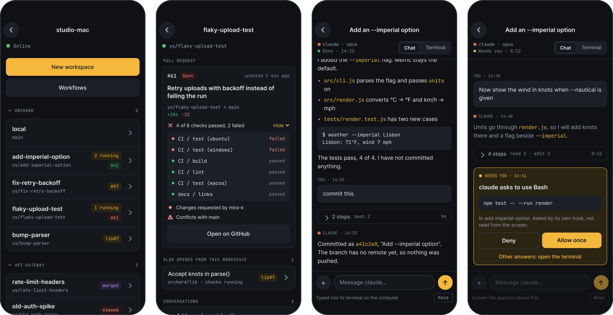

# The phone app

> **Invite only for now.** A small group is trying the app, and it will be in the app stores in a
> few weeks. To try it before then, [write to us](mailto:hello@yardsort.sh). It is part of
> [Remote](remote.md), which is still under development: expect it to change.

Yardsort on your phone reaches the agents on your computer. See what each workspace is doing, read a
conversation, answer what an agent asks, and start new work, away from your desk. The agents run on
the computer, not on the phone, so they keep going whatever happens to the connection.

## What you can do with it

- **See a computer's workspaces.** Each project with its workspaces, their branches, how many
  agents are running and each one's pull request. A project folds to put its workspaces away. See
  [A computer's workspaces](remote.md#a-computers-workspaces).
- **Read a conversation as a chat.** What you asked, the agent's steps folded to one line, and what
  it wrote back, in one column at the phone's width. Type a message, stop the agent, or give it a
  picture. **Terminal** shows the terminal itself. See [Chat on the phone](remote.md#chat-on-the-phone).
- **Answer a permission question.** When Claude Code asks to run a command, the chat shows it with
  **Allow once** and **Deny**. See
  [When an agent asks for a permission](remote.md#when-an-agent-asks-for-a-permission).
- **Let a smoke test run.** A test that waits for your approval shows its steps, with **Run** and
  **Don't run**. See [When a smoke test waits for you](remote.md#when-a-smoke-test-waits-for-you).
- **Follow pull requests.** A badge on each workspace, a card with the checks by name and the
  review, and a list of the open, merged and closed ones over every project. Read-only. See
  [Pull requests on the phone](remote.md#pull-requests-on-the-phone).
- **Start work.** A new workspace, another agent in one you have, or a conversation that ended,
  resumed. See [Starting work from the phone](remote.md#starting-work-from-the-phone).
- **See what waits, in one list.** The bell opens **Notifications**: what needs you and what
  finished while you were not looking, on every computer the phone can reach. A computer's row
  says how many, and its workspaces are marked. Opening a finished row marks it seen on the
  computer too. See [Notifications](notifications.md#on-the-phone).
- **Be told when something needs you.** A task that moved, a review, a failed run, an agent or a
  workflow waiting for an answer, or an agent that finished while nobody looked. The
  notification opens that item. See [Notifications](remote.md#notifications).
- **Export your account.** Settings → Your account saves everything the server keeps of it as a
  file, never a credential. See [Exporting your account](remote.md#exporting-your-account).
- **Delete your account.** Settings → Your account → Delete my account removes everything the
  server keeps of it, for every device, after you type delete and sign in again. Nothing on your
  computers is deleted. See [Deleting your account](delete-account.md).

## What it needs

1. **Yardsort on your computer, with Remote on.** Remote is off until you turn it on in
   **Settings → Remote**, where you sign in to a Yardsort server. See
   [Turning it on](remote.md#turning-it-on).
2. **The app on your phone**, signed in to the same server.
3. **A yes at the computer.** **Pair a device** on the computer shows a code. Enter it on the phone,
   then say yes at the computer and choose whether the phone may only watch or also type, and which
   projects it reaches. See [Letting a device in](remote.md#letting-a-device-in).

The phone reaches your computer through that server. **Whoever runs the server can see what passes
through it**, so use one you run yourself or one run by someone you trust with that: see
[What the server can see](remote.md#what-the-server-can-see).

A Linux server with no screen can be the computer your phone reaches too: see
[A computer with no screen](headless-host.md).

## Where to get it

Not in the app stores yet. It is invite only while a small group tries it, and it will be in the
stores in a few weeks. [Write to us](mailto:hello@yardsort.sh) if you would like to try it early.

The app is open source, like the rest of Yardsort. Its code is in
[`apps/mobile`](https://github.com/joaoh82/yardsort/tree/main/apps/mobile), under the MPL-2.0.
