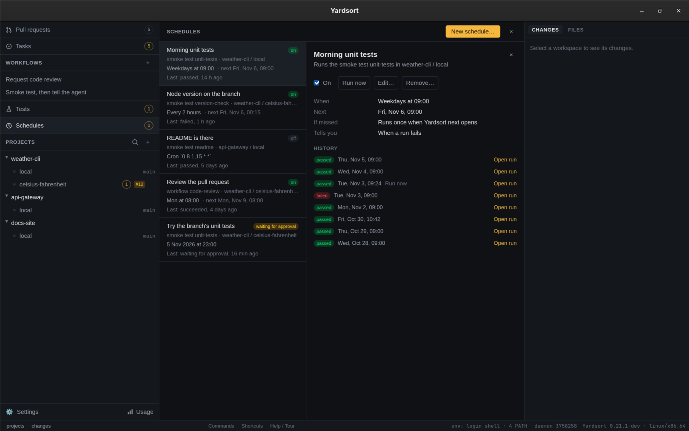

# Schedules

A schedule starts a [workflow](workflows.md) or a [smoke test](smoke-tests.md) without you
pressing **Run**: once, at a time you pick, or again and again — every weekday at nine, every two
hours, the first of the month. A repeating schedule is what you might call a routine. It runs in
a workspace you already have, with the inputs you gave it, and what it starts is an ordinary run:
it shows in the workflow's runs or in **Tests** like any other, marked as scheduled.

Three things to know before you make one:

- **Schedules fire while Yardsort is open.** The app is what carries runs out, so a time that
  comes while it is closed, or while the computer is asleep, is _missed_. Each schedule says what
  to do about that: run once when Yardsort next opens, or skip it. See
  [A missed time](#a-missed-time).
- **Times are this computer's local time.** _Daily at 09:00_ is nine o'clock where the computer
  is, summer and winter.
- **A schedule approves nothing.** A smoke test file nobody has approved waits for you, as it
  does when an agent runs it. See [Smoke tests on a schedule](#smoke-tests-on-a-schedule).

## Making a schedule

**Schedules**, in the sidebar under **Tests**, opens every project's schedules in the center
panel. **New schedule…** opens the dialog. So does **Schedule…** beside **Run…** on a workflow
and on a test, and **Schedule…** in a workspace's **⋯** menu, each with what it already knows
filled in.

The dialog asks, in order:

| Field               | What it is                                                                         |
| ------------------- | ---------------------------------------------------------------------------------- |
| Run                 | A workflow or a smoke test                                                         |
| In workspace        | Where to run it: any workspace that is not archived, a project's `local` included  |
| Workflow or test    | Which one. Tests are the ones in the chosen workspace's `.yardsort/tests`          |
| Its inputs          | The same questions **Run…** asks, starting from their defaults                     |
| When                | See [When](#when). The next few times are shown as you fill it in                  |
| If a time is missed | **Run once when Yardsort next opens** (the default) or **Skip it**                 |
| Tell me             | **When a run fails** (the default), **How every run ends**, or **Never**           |
| Name                | What the list calls it. Left empty, it takes the workflow's or the test's own name |

Saving checks everything a run would be refused for — the workspace is there and not archived,
the workflow or the test is there and ready, every required input is given — so a mistake is
told to you now rather than at three in the morning. All of it is checked again each time the
schedule fires, since any of it can change in between.

A schedule runs one thing in one workspace. To run two things, make two schedules, or a workflow
with two steps. A workflow that runs a smoke test with its `run_test` step is scheduled like any
other, as long as the test can run with nobody there: see
[Workflows that run a smoke test](#workflows-that-run-a-smoke-test).

### When

| Choice          | You give                           | Reads as                      |
| --------------- | ---------------------------------- | ----------------------------- |
| Once            | A date and a time                  | "6 Nov 2026 at 18:00"         |
| Every…          | A number of minutes, hours or days | "Every 2 hours"               |
| Daily           | A time                             | "Daily at 09:00"              |
| Weekly          | One or more weekdays and a time    | "Weekdays at 09:00"           |
| Monthly         | A day from 1 to 28, or the last    | "Monthly on the 1st at 09:00" |
| Advanced (cron) | A five-field cron expression       | "Cron `0 9 * * 1-5`"          |

- **Every…** counts from when the schedule last fired, or from when it was saved. The shortest
  is one minute.
- **Monthly** stops at the 28th, with **Last day** as its own choice, so no schedule silently
  skips February.
- **Cron** is the usual five fields — minute, hour, day of the month, month, day of the week —
  with lists (`8,20`), ranges (`1-5`), steps (`*/15`) and names (`mon`, `jan`). There is no
  seconds field. Whatever you type, the dialog shows the next times it means, or what is wrong
  with it.
- **Once** must be in the future. After it fires it stays in the list, marked **done**, until
  you remove it. One that never ran says so instead: **missed** when its time passed while
  Yardsort was closed and it skips those, **refused** when its run could not start.

On the night the clocks go forward, a time that does not exist that night fires at the next
minute that does. On the night they go back, a time that happens twice fires once.

### A missed time

A time is missed when Yardsort notices it more than five minutes late: the app was closed, or
the computer was asleep.

- **Run once when Yardsort next opens.** One run, however many times were missed. A daily
  schedule on a laptop closed for a week runs once on Monday morning, not seven times.
- **Skip it.** Nothing runs; the history shows the time as _missed_.

Either way the next time is worked out from now.

## The Schedules view



Each row shows the schedule's name, what it runs and where, when in words, the next time it
fires, how its last time went, and where it stands:

| Badge                | Meaning                                                                       |
| -------------------- | ----------------------------------------------------------------------------- |
| on                   | Waiting for its next time                                                     |
| running              | The run it started is going                                                   |
| waiting for approval | Its run waits for you to approve the test file                                |
| refused              | Its last time could not start a run; the history says why                     |
| no workspace         | Its workspace was deleted. It fires nothing until you edit it to pick another |
| off                  | You switched it off                                                           |
| done                 | A **Once** that has had its time, and ran                                     |
| missed               | A **Once** whose time passed while Yardsort was closed, and that skips those  |

The number on **Schedules** in the sidebar is how many are _waiting for approval_, _refused_ or
have _no workspace_: the ones that need you.

A row opens to the schedule's details, with:

- **The switch.** Off keeps the schedule and its history and fires nothing. Switching it back on
  starts from now: times that passed while it was off are not made up for.
- **Run now** starts its run at once and leaves its next time where it is.
- **Edit…** opens the dialog on what the schedule holds. A schedule that was switched off stays
  off when it is saved.
- **Remove…** asks first. It removes the schedule and its history. The runs it started stay in
  the workflow's runs and in Tests.
- **History**: every time the schedule came due, newest first, and what became of it.

| In the history                     | Meaning                                                                            |
| ---------------------------------- | ---------------------------------------------------------------------------------- |
| running, passed, failed, finished… | A run was started; this is how it stands, or how it ended. **Open run** goes to it |
| skipped                            | The previous run was still going, so no second one was started                     |
| missed                             | The time passed while Yardsort was not running, and this schedule skips those      |
| refused                            | A run could not be started, with the reason                                        |

A schedule never starts a second run of the same thing in the same workspace while the first is
going. A schedule that fires every ten minutes with a run that takes twenty skips every other
time; nothing piles up.

**Refused** is whatever a run would be refused for at that moment: the workspace is archived,
the workflow or the test file is gone or no longer valid, an input no longer fits, a test's
`browser` step has no browser, a value it reads from the project's test environment is not set,
a smoke test the workflow runs would wait for you. A workflow that works with the workspace's
pull request asks GitHub for it first, and is refused when `gh` has not answered in 20 seconds.
The schedule stays on and tries again at its next time, so fixing the cause is all it takes.

One refusal does not mend itself: Yardsort cannot work out the schedule's next time, which
takes a schedule written by a newer Yardsort than the one running. It stays on, reads
**refused**, and fires nothing until you edit it.

## Being told

A scheduled run has nobody watching it, so the schedule can tell you how it ended, with a
desktop notification:

- **When a run fails** — a workflow that failed, a smoke test that failed or could not finish.
- **How every run ends** — those, and the ones that passed or were cancelled.
- **Never.**

A workflow that stops because a smoke test gate failed is a failed run. The notification is
the first line of the reason, and says to open Yardsort for the report.

A run that waits for your approval is told once, whichever of the first two you chose. So is a
time that was **refused**, since no run will end to tell you about: once when it starts being
refused, not again at every time that comes while the cause is still there.

## Smoke tests on a schedule

A smoke test file comes from a repository and says what to run on your computer, so it never
runs until you have seen it. That holds on a schedule:

- **Making the schedule in the app shows the file's steps, and saving approves that file**, as
  pressing **Run** does. Its scheduled runs then go straight ahead.
- **If the file changes** — an agent edits it, a pull or a rebase brings a new version — the next
  scheduled run waits for approval on the card at the top of its workspace, the schedule shows
  _waiting for approval_, and you are told. Approve it and that run goes; the runs after it go
  straight ahead again. Until you do, each time that comes is _skipped_, since that run is in
  the way, and the schedule goes on showing _waiting for approval_ and being counted on
  **Schedules** in the sidebar.
- A project set to **ask every time** asks every time here too.
- **A test with a `manual` step cannot be scheduled.** A step a person answers would wait for
  nobody. The dialog says so when you save.

### Workflows that run a smoke test

A workflow's `run_test` step waits for its test, and a test that waits for you — for approval,
or at a `manual` step — would hold the workflow's run open with nobody coming. Every later time
of the schedule would then be skipped behind it. So a scheduled workflow never waits for a
person:

- **Saving is refused** when a `run_test` step names a test that has a `manual` step, whose file
  is not approved as it is now, or whose project asks every time. The message names the step and
  the test. Run the test once in that workspace to approve it, then save the schedule.
- **Each time is checked again.** If the file has changed since, that time is **refused**, and
  you are told. Approve the file by running it, and the next time goes ahead.
- **A test named by an input** (`test: "{{ inputs.suite }}"`) is not known until the run. The
  run starts, and that step fails at once with the reason, instead of waiting. The workflow's
  run ends as failed, and you are told as for any failure.

**Run now** is you asking, so its run may wait for you as a run you start does.

## Agents on a schedule

A scheduled workflow starts its agents the way a workflow you run does. If an agent stops to ask
for permission, it waits in its terminal, the workflow's step runs into its timeout, and the
usual "is waiting" notification fires. Nothing answers on your behalf.

## From the command line

```sh
ys schedule list
ys schedule add --test login --workspace local --weekly mon-fri 09:00
ys schedule add --workflow code-review --workspace fix-login --input reviewer=codex --daily 18:30
ys schedule add --test login --at "2026-11-06 18:00"
ys schedule add --workflow nightly --cron "0 3 * * *" --if-missed skip --notify always
ys schedule show Nightly
ys schedule pause Nightly
ys schedule resume Nightly
ys schedule run Nightly
ys schedule runs Nightly
ys schedule remove Nightly
```

See [`ys schedule`](cli.md#ys-schedule) for each of them. Schedules made from a terminal appear
in the app at once, and the other way round. `ys` cannot approve a smoke test file, so a test
scheduled from a terminal waits for approval in the app the first time, unless its file is
already approved.

## What it does not do

- **Run while Yardsort is closed.** A missed time is handled, not prevented.
- **Make a fresh worktree for each run.** It runs in the workspace you chose, on whatever is
  checked out there.
- **React to things that happen.** A schedule knows only the clock; a [trigger](triggers.md)
  starts a run when an agent says it is done, a test fails, or a run ends.
