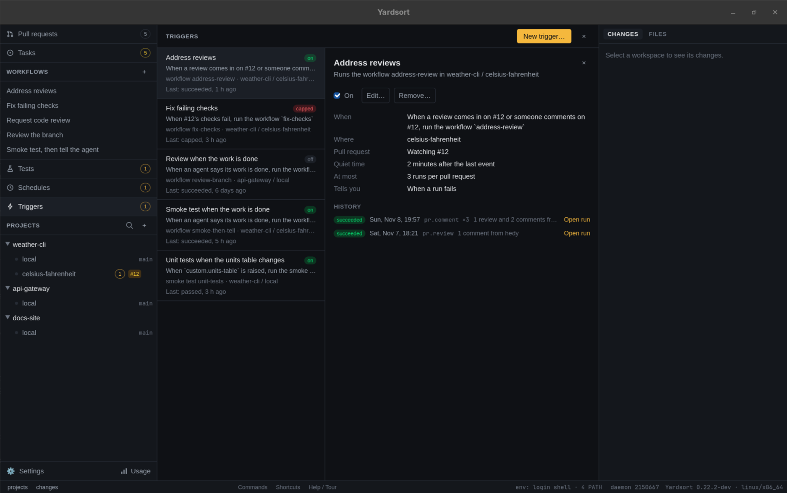

# Triggers

A trigger starts a [workflow](workflows.md) or a [smoke test](smoke-tests.md) when something happens
in a workspace, instead of when you press **Run** or a [schedule](schedules.md)'s time comes: an
agent says its work is done, an agent finishes a turn or exits, a smoke test or a workflow run ends,
something happens on the workspace's pull request — it opens, a review or a comment comes in, its
checks fail — or something you name happens, which an agent, a smoke test or a script says with
[`ys event emit`](#custom-events). What it starts is an ordinary run, in that workspace, with the
inputs you gave the trigger.

For example: when someone reviews the pull request of `fix-login`, tell its agent to address the
review. Or: when the agent says it is done, have a second agent review the branch.

**Triggers** in the sidebar, under **Schedules**, lists every trigger of every project; the
composer offers the [ready-made ones](#ready-made-triggers) for each new workspace; and
`ys trigger` does all of it from a terminal. The runs show in the workflow's runs and in
**Tests** like any other, marked _triggered_ with the trigger's name.



Three things to know before you make one:

- **Triggers fire while Yardsort is open.** What happened while it was closed — an agent that ran
  `ys workspace done` or `ys event emit`, a run that ended, a turn its agent reported, a review
  posted — is found when it next opens, and acted on once.
- **Only what happens after you make it counts.** A trigger never fires for something that
  happened before it was saved, or while it was switched off.
- **A trigger approves nothing.** A smoke test file nobody has approved waits for you, as it does
  when an agent runs it. See [Smoke tests and approval](#smoke-tests-and-approval).

## Ready-made triggers

Five triggers come ready made, each an event and a built-in
[workflow](workflows.md#where-workflows-come-from), with at most one question:

| Preset               | When                                                                        | Runs              | Asks for                  |
| -------------------- | --------------------------------------------------------------------------- | ----------------- | ------------------------- |
| `address-reviews`    | Someone other than you reviews or comments on the pull request, 2 min quiet | `address-review`  |                           |
| `fix-checks`         | The checks on the pull request's newest commit fail                         | `fix-checks`      |                           |
| `review-when-opened` | The pull request opens, or a draft is marked ready                          | `code-review`     | `reviewer`: who reviews   |
| `review-when-done`   | The agent says its work is done                                             | `review-branch`   | `reviewer`: who reviews   |
| `smoke-when-done`    | The agent says its work is done                                             | `smoke-then-tell` | `suite`: which smoke test |

**In the composer**, under the message, each preset has a box to tick, with its one question beside
it: _☐ Review when the work is done, by [Codex ▾]_. Each one ticked becomes a trigger on the new
workspace before its agent starts, so an agent whose workspace listens for
[`ys workspace done`](#the-done-signal) is told about it in its first message. The composer
remembers, per project, which were ticked last time and their answers. **Smoke test when the work is
done** offers the smoke tests in the project's own checkout, and cannot be ticked in a project that
has none. While those tests are still being read, a ticked one says so and **Start** waits, so it is
never left out unasked. A preset that cannot be added — its test is not on the new branch, say — is
said once the workspace has started; the workspace and its agent start all the same.

**In the trigger dialog**, **Start from** fills the dialog in from a preset, to change before
saving. Left without a name, the trigger is called what the preset is.

```sh
ys trigger presets
ys trigger add --preset address-reviews --workspace fix-login
ys trigger add --preset review-when-done --input reviewer=codex --workspace fix-login
```

A trigger made from one is an ordinary trigger: its quiet time, cap, name and when you are told
change as they would any other's.

## Making a trigger

**New trigger…** at the top of the **Triggers** view opens the trigger dialog. **Triggers…** in a
workspace's **⋯** menu opens the view on that workspace's triggers, and in an agent tab's menu on
that agent's own; a new trigger made there starts on it. **Show all** goes back to every trigger.

The dialog asks its questions in the order they can be answered:

- **Where**: the workspace, and whether the trigger listens to any agent in it or only to one
  (see [One agent's trigger](#one-agents-trigger)).
- **When**: the [events](#what-it-listens-for), in four groups — the agent, a run, the pull
  request, something you name — then the filters of the ones ticked. A trigger is about one kind
  of thing — an agent, the pull request, or the workspace — so events about another are greyed
  out once one is ticked; make a second trigger for those. **A custom event** asks for the
  [names](#custom-events) it listens for, and offers the ones the project's other triggers use.
- **Run**: a workflow or a smoke test, then its inputs, asked as **Run…** asks them.
- **Quiet time**, **At most** (the cap) and **Tell me**, then an optional name.

As it is filled in, it says what will happen in words: _When someone other than you reviews or
comments on this workspace's pull request, 2 minutes after the last one, tell the agent to address
it. At most 3 times per pull request._ **Add trigger** checks everything a run would be refused
for, as `ys trigger add` does, and says what is wrong without closing.

From a terminal:

```sh
ys trigger add --on pr.review --on pr.comment --workflow address-review --workspace fix-login
ys trigger add --on workspace.done --workflow smoke-then-tell --input suite=login --workspace fix-login
ys trigger add --on agent.exited --failed-exit --workflow tell-me --workspace fix-login
ys trigger add --on test.finished --of-test login --verdict failed --workflow fix-it
ys trigger add --on custom.migration-written --test migrations --workspace fix-login
```

`--on` says what to listen for; give it more than once for more than one event. `--workflow` or
`--test` says what to run, and `--input id=value` gives each of its inputs. `--workspace` takes a
workspace's name or id, and can be left out inside a workspace's folder or in an agent's terminal
there. Everything a run would be refused for is checked before anything is written: the workspace
is there and not archived, the workflow or the test is there and ready, its inputs fit, and the
filters are ones the events have.

| Option        | What it is                                                                                                                |
| ------------- | ------------------------------------------------------------------------------------------------------------------------- |
| `--preset`    | A [ready-made trigger](#ready-made-triggers), in place of `--on` and what to run                                          |
| `--on`        | An event, below. More than once for more than one                                                                         |
| `--workflow`  | Run this workflow, or                                                                                                     |
| `--test`      | run this smoke test, from the workspace's `.yardsort/tests`                                                               |
| `--workspace` | Where. Default: the workspace this is run in                                                                              |
| `--session`   | Only this agent session's events, by its id or the start of it. See [One agent's trigger](#one-agents-trigger)            |
| `--input`     | `id=value`, for each of the target's inputs                                                                               |
| `--name`      | What lists call it. Default: the workflow's or the test's own name                                                        |
| `--quiet`     | Wait this long after the last event before starting the run: `30s`, `2m`. Default: 2m for reviews and comments, else none |
| `--cap`       | Runs it may start for one agent session, one pull request, or the workspace, before it stops. Default: 3                  |
| `--notify`    | `failure` (the default), `always` or `never`: when to be told how a run ended                                             |

## What it listens for

| Event               | Happens when                                                                    | Filters                                                 |
| ------------------- | ------------------------------------------------------------------------------- | ------------------------------------------------------- |
| `workspace.done`    | An agent ran [`ys workspace done`](#the-done-signal)                            |                                                         |
| `agent.settled`     | An agent finished a turn: it went quiet after real work, or its harness said so | `--new-commits`, `--clean`                              |
| `agent.exited`      | An agent's program ended                                                        | `--failed-exit`                                         |
| `test.finished`     | A smoke test run in the workspace reached a verdict, or could not               | `--of-test <id>`, `--verdict passed` or `failed`        |
| `workflow.finished` | A workflow run in the workspace ended                                           | `--of-workflow <id>`, `--outcome succeeded` or `failed` |
| `pr.opened`         | The workspace's branch has an open pull request it did not have before          | `--drafts`                                              |
| `pr.review`         | A review was submitted on the workspace's pull request                          | `--from`, `--state`, `--no-bots`                        |
| `pr.comment`        | A comment on its conversation, or a reply on a review thread                    | `--from`, `--no-bots`                                   |
| `pr.checks_failed`  | Its checks finished on its newest commit, and one failed                        |                                                         |
| `pr.checks_passed`  | Its checks finished on its newest commit, and none failed                       |                                                         |
| `pr.conflicted`     | GitHub says it conflicts with its base                                          |                                                         |
| `pr.merged`         | It was merged                                                                   |                                                         |
| `pr.closed`         | It was closed without being merged                                              |                                                         |
| `custom.<name>`     | Someone ran [`ys event emit <name>`](#custom-events) in the workspace           |                                                         |

- **An agent's events** are about the agents you started in the workspace. A shell is not an
  agent, and neither is an agent a workflow run started: the reviewer of a code review finishing
  its turn sets nothing off. An agent's events, the pull request's and the workspace's cannot
  share one trigger, since each counts its runs for something different; make two.
- **`agent.settled` fires at every turn**, including a turn where the agent stops to ask you
  something. That is what "tell me each time it stops" wants, and not what "it is finished"
  means. `--new-commits` waits for the branch to have commits it did not have the last time this
  trigger started a run for that agent, or, the first time, commits its base branch does not
  have. `--clean` waits for nothing to be uncommitted. Both are looked at when the run would
  start, after the quiet time. For "the work is done", `workspace.done` is the surer one.
- **`--failed-exit`** is a code that is not 0, a program that was stopped, or one that ended
  without Yardsort hearing how.
- **`--verdict failed`** includes a run that could not finish; **`--outcome failed`** includes a
  cancelled run.
- **The pull request's events** are about the open pull request for the branch the workspace has
  checked out, on GitHub, as `gh` sees it. See [Watching a pull request](#watching-a-pull-request).
  A trigger whose workflow is about a pull request the workspace tracks in another repository
  hears those instead: see [Pull requests elsewhere](#pull-requests-elsewhere).

## Watching a pull request

While an enabled trigger in a workspace listens for a `pr.*` event, Yardsort looks at that
workspace's pull request once a minute, with `gh`, and starts what the trigger starts when
something changed since the last look. Nothing is asked of GitHub for a workspace no trigger
watches.

- **What is there when you add the trigger is not news.** Adding it reads the pull request as it
  is: a pull request already open is not `pr.opened`, checks already red are not
  `pr.checks_failed`, and a review already posted is not `pr.review`. `ys trigger add` says which
  pull request it is watching, or that there is none yet.
- **Reviews and comments count when they are someone else's.** You and every agent post to GitHub
  as your `gh` account, and the agent answering a review answers each comment as you. So by
  default only posts from other accounts count — a teammate, a review bot. `--from anyone`
  counts yours too, except what is posted while a run this trigger started is going, which is the
  agent's own answers. `--no-bots` leaves out accounts whose name ends in `[bot]`. `--state`
  (`approved`, `changes_requested`, `commented`) narrows `pr.review` to reviews that concluded
  that.
- **A reply on a review thread is a comment.** GitHub also records each reply as a review of its
  own; Yardsort counts it once, as `pr.comment`. A review is the review's verdict and words with
  the comments on lines made in it.
- **Reviews and comments come in bursts**, so a trigger on them waits two minutes after the last
  one by default and starts one run for all of them.
- **Checks are told once they have all finished**: `pr.checks_failed` when nothing is running and
  something failed, `pr.checks_passed` when nothing is running and nothing failed. Every check on
  the commit is counted, however many there are, and one GitHub has marked stale counts as
  finished. Each is told once per commit, so a push that fails again is news again.
- **A draft** is `pr.opened` when it is marked ready for review. `--drafts` counts it as soon as
  it opens instead.
- **`pr.merged` and `pr.closed`** are told once. A different pull request opened on the branch
  afterwards is `pr.opened`, and counts its own runs; the same one reopened is not new, and what
  was already on it is not news again. A workflow that needs the open pull request —
  `{{ pr.* }}`, `wait_pr_activity` — cannot run on these, and saving says to use `{{ event.url }}`,
  `{{ event.number }}` and `{{ event.title }}` instead.
- **GitHub not answering** — no network, `gh` logged out — is no news; the trigger looks again a
  minute later.

## Pull requests elsewhere

A workspace can [track pull requests in other repositories](commits-and-pull-requests.md) — the
ones its agent opens in a nested clone of the project's folder, with `ys pr track`. A trigger
hears their `pr.*` events when its workflow is about such a pull request (`context:
tracked_pull_request`): **Request code review elsewhere** (`code-review-elsewhere`), **Address
reviews elsewhere** (`address-review-elsewhere`), or one of your own. Such a trigger hears every
pull request the workspace tracks, each on its own, and none of the workspace's own; a trigger
whose workflow is about the workspace's own pull request hears only that one. So to have both
reviewed, make two triggers.

```sh
ys trigger add --on pr.opened --workflow code-review-elsewhere --input reviewer=codex --workspace fix-login
ys trigger add --on pr.review --on pr.comment --workflow address-review-elsewhere --workspace fix-login
```

In the trigger dialog, the workflows about one elsewhere are under **On a pull request it tracks
elsewhere**, offered unless an event that is not the pull request's is ticked; once one is
chosen, the other events are greyed out.

- **Being tracked is `pr.opened`.** An agent tracks the pull request it has just opened, so
  `pr.opened` is the workspace tracking one — by `ys pr track`, **Track pull request…**, or the
  agent's own reporting — when Yardsort looks at it within ten minutes of the tracking. One
  tracked longer before its first look is only watched from then on. A draft counts once it is
  marked ready, or at once with `--drafts`.
- **What is there when you add the trigger is not news**, for each pull request already tracked,
  as for the workspace's own. Reviews and comments posted before a pull request was tracked are
  not news either.
- **Each counts its own runs.** The cap is per pull request, and two with the same number in
  different repositories are two.
- **The run is about the one that set it off**, read again by its link when the run starts:
  `{{ pr.* }}`, `pr.repo` and `pr.clone` are that pull request's, and `session: origin` is the
  agent that opened it while it runs, else the workspace's own agent. One no longer tracked, or
  no longer open, is **refused**, with the reason.
- **Only the pull request's events.** Such a workflow is always about one pull request, so a
  trigger cannot start it on the workspace's or an agent's events, nor on `pr.merged` or
  `pr.closed`, after which it is not open.
- **A merged or closed one** is told once, as the workspace's own is, then looked at every ten
  minutes rather than every minute, for its reopening. **Stop tracking** one and it is no longer
  watched.

The trigger's details list the pull requests it watches.

## The done signal

```sh
ys workspace done
ys workspace done --note "Login validates on blur; tests added."
```

`ys workspace done`, run in an agent's terminal, says the work in that workspace is committed and
ready to be looked at. A trigger on `workspace.done` starts what it starts. The note, if there is
one, is there for the workflow as `{{ event.note }}`, and the commit the worktree was on as
`{{ event.head }}`. Outside an agent's terminal, run it in the workspace's folder or give
`--workspace`. It prints whether a trigger there listens for it.

**An agent is told about it** in its first message — a short section after the project's memory
and the smoke tests — when a trigger in its workspace listens for `workspace.done` at the moment
it starts. It is asked to run it once its work is committed, and not to pause or to ask a
question. An agent that was already running when you added the trigger was not told; `ys trigger
add` says so, and the trigger dialog offers **Tell the agent**: it types the same paragraph into
each of them, once it is quiet, never into one that is working. Agents started from then on are
told when they start.

Yardsort reads nothing an agent prints to know it is done: the agent runs a command, as it runs
`git` or `gh`.

## Custom events

```sh
ys event emit migration-written
ys event emit migration-written --note "0042 adds users.last_seen"
```

A custom event is for what no event above covers: a milestone of your own, said in your own
words. `ys event emit <name>` raises it in the workspace it is run in, and a trigger there on
`custom.<name>` starts what it starts. It can come from:

- **An agent**, when its instructions say to run it — your `AGENTS.md`, the first message, or
  the message a workflow sends it. Yardsort tells an agent about `ys workspace done`, but not
  about your own events: it cannot know when yours should be raised.
- **A smoke test's `run` step**, as a command like any other. A run a trigger on it starts counts
  as one step further along a chain, as the end of a run does, so tests that raise each other's
  events stop (see [Chains](#when-a-run-starts)).
- **A script, a git hook, or you**, in the workspace's folder, or anywhere with `--workspace`.

A name is lowercase letters, digits, `-` and `_`, starting with a letter or a digit, up to 40
characters; `ys event emit custom.migration-written` is taken too. Nothing has to be declared
first. Instead, `ys event emit` says whether a trigger there listens for that name, and when none
does, which names they do listen for, so a typo shows at once. One trigger can listen for more
than one name, with `--on` once for each. Each name is gathered on its own: two different names
raised together start two runs, one after the other, each with its own name and note, while the
same name twice is one run with the newer note, as any burst is. A custom event is about the
workspace, so it can share a trigger with `workspace.done`, `test.finished` and
`workflow.finished`, and the cap counts per workspace. `--note` is there for the workflow as
`{{ event.note }}`, the name as `{{ event.name }}`, and the commit the worktree was on as
`{{ event.head }}`. Raised while Yardsort is closed, even before it has ever opened, it is heard
when it next opens, by the triggers that were saved before it was raised.

## When a run starts

**A burst is one run.** With `--quiet 2m`, the trigger waits until nothing new has happened for two
minutes, then starts one run for everything that came — but never later than ten minutes after
the first. For `agent.settled`, the agent going back to work before the quiet time is up means
that turn did not end, and nothing starts. Without `--quiet`, a run starts within a second.

**A run in the way makes it wait.** Only one run of a workflow, or of a test, goes at a time in a
workspace, whoever started it. When the trigger's run would be the second, the trigger waits,
and starts it when the first ends, with everything that came meanwhile. A schedule skips such a
time, because another time will come; something that happened will not happen again.

**It stops before it loops.** Three limits, each told to you once:

- **The cap.** At most `--cap` runs — three by default — for one agent session, for an agent's
  events, for one pull request, for the pull request's, or for the workspace, for the rest. The next
  fire is **capped**, you are told, and the trigger starts nothing more for it until you press
  **Reset** on it in the **Triggers** view, or run `ys trigger reset`.
- **The rate.** At most ten runs an hour for one trigger, whatever the cap.
- **Chains.** A run a trigger started can end in an event another trigger listens for. A run a
  person or a schedule started is depth 0; a run started by the ending of a run of depth _n_ is
  _n_ + 1, and so is one started by a custom event a smoke test run of depth _n_ raised from its
  `run` step. A fire past depth 3 is refused. An event an agent raises is depth 0, as
  `ys workspace done` is: an agent told to raise one by a triggered run is held back by the cap
  and the rate.

### One agent's trigger

`--session <id>` makes a trigger that belongs to one agent session: it hears that agent's own
turns and exits, and its runs' `session: origin` is that agent, whichever agent in the workspace is
newest. A fire while that agent's program is not running is **skipped**: there is no one to tell.
The trigger goes when the session's record does. `ys session list` shows the ids.

### No agent to tell

A workflow that tells the workspace's own agent something — `address-review`, `fix-checks`, the
last step of `review-branch` — has nothing to do when no agent is running there. Such a fire is
**skipped**, and you are told once, rather than starting a run that skips every step and calls
that a success. Start an agent in the workspace and the next event reaches it.

### Smoke tests and approval

A smoke test file comes from a repository and says what to run on your computer, so it never runs
until you have seen it. A trigger keeps to that: a run of a new or changed file waits on the card
at the top of its workspace, the trigger reads _waiting for approval_, and you are told once
(see [Being told](#being-told)).
Approve it and that run goes. Meanwhile the trigger's next events wait behind it.

Nothing else a person does is waited for:

- **A test with a `manual` step cannot be triggered.** Nobody is there to press **Pass**. This is
  checked when the trigger is saved and again each time it fires, for a test it runs itself and
  for one a workflow's `run_test` step names.
- **A workflow's `run_test` steps each need a `timeout`.** A test named by an input is not known
  until the run, and an approval may not come; the timeout ends the wait.

## What the workflow is told

A workflow a trigger starts can read what set it off as `{{ event.* }}`:

| Variable                      | What it is                                                                                                                                                                                                                        |
| ----------------------------- | --------------------------------------------------------------------------------------------------------------------------------------------------------------------------------------------------------------------------------- |
| `event.kind`                  | The event: `workspace.done`, `agent.settled`, `custom.migration-written`, …                                                                                                                                                       |
| `event.count`                 | How many events the run is for, when a burst was gathered into one                                                                                                                                                                |
| `event.note`                  | `workspace.done`, `custom.<name>`: what was passed to `--note`                                                                                                                                                                    |
| `event.name`                  | `custom.<name>`: the name, without `custom.`                                                                                                                                                                                      |
| `event.head`                  | `workspace.done`, `agent.settled`, `custom.<name>`: the commit the worktree was on. `pr.checks_failed`, `pr.checks_passed`, `pr.conflicted`: the commit it was about                                                              |
| `event.summary`               | `agent.exited`, `test.finished`, `workflow.finished`: how it ended, in a line. `pr.review`, `pr.comment`: _2 reviews and 3 comments from alice and coderabbitai[bot]_. `pr.checks_failed`: _2 checks failed: lint, test (ubuntu)_ |
| `event.verdict`               | `test.finished`: `passed`, `failed`, `errored`, …                                                                                                                                                                                 |
| `event.url`                   | The `pr.*` events: the pull request, or for a review or comment, the newest one                                                                                                                                                   |
| `event.number`, `event.title` | The `pr.*` events: the pull request's number and title                                                                                                                                                                            |
| `event.authors`               | `pr.review`, `pr.comment`: who posted, comma-separated                                                                                                                                                                            |

A trigger whose workflow uses a variable one of its events does not leave is refused when it is
saved, naming it. Run by hand, every `event.*` is empty, and **Run…** and `ys workflow run` say
so.

## Being told

A triggered run has nobody watching it, so the trigger can tell you how it ended, with a desktop
notification: **when a run fails** (the default), **how every run ends**, or **never**. Unless it
is set to never, a run waiting for your approval is told once, and so is a trigger that is capped,
could not start its run, or had no agent to tell, once while it lasts.

## Its history

In the **Triggers** view each trigger shows its event in words — _When a review comes in on
#142_ once its pull request is known — where it is, what it runs, how its last fire went, and a
badge: **on**, **running**, **waiting**, **waiting for approval**, **capped**, **refused**,
**off**, **no workspace** when its workspace was deleted, or **ended** when the agent it belongs
to has ended. The number beside **Triggers** in the sidebar counts those that need you: capped,
refused, waiting for approval, or with no workspace.

A trigger opens to its switch, **Edit…**, **Reset** when it is capped, **Remove…**, what it is
set to, the pull request it is watching — or the ones elsewhere —, and its history, newest first, each line with **Open
run** when it started one: that run, open in the workflow's view or the workspace's smoke tests.
`ys trigger fires <trigger>` lists the same:

| Outcome                            | Meaning                                                                      |
| ---------------------------------- | ---------------------------------------------------------------------------- |
| running, succeeded, passed, failed | A run was started; this is how it stands, or how it ended                    |
| waiting for approval               | Its run waits for you to approve the test file                               |
| waiting                            | A run of the same thing is going there; this one starts when it ends         |
| skipped                            | Its agent session, or any agent in the workspace, was not running to be told |
| capped                             | It had started as many runs as `--cap` allows. Later events go on this line  |
| refused                            | A run could not be started, with the reason                                  |

## From the command line

```sh
ys trigger presets              # the ready-made triggers
ys trigger list                 # every trigger: what it listens for, what it runs, where, how it stands
ys trigger show Tell            # its events, filters, inputs, limits and last fire
ys trigger pause Tell           # off: keeps its history, fires nothing
ys trigger resume Tell          # on again; only what happens from now counts
ys trigger reset Tell           # lift its cap
ys trigger fires Tell           # its history
ys trigger remove Tell          # the trigger and its history; the runs it started stay
```

A trigger is named by its name, its id, or the start of its id. `--json` works as everywhere.
See [`ys trigger`](cli.md#ys-trigger).

## What it does not do yet

- **Forges other than GitHub.** The pull request events need `gh`.
- **A workflow step that raises a custom event.** A workflow raises one through a smoke test it
  runs, or by asking its agent to; its own ending is `workflow.finished`.
- **Run while Yardsort is closed.** What happened is found when it next opens.
