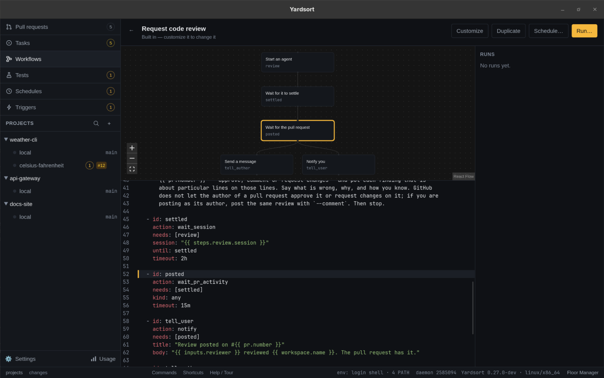
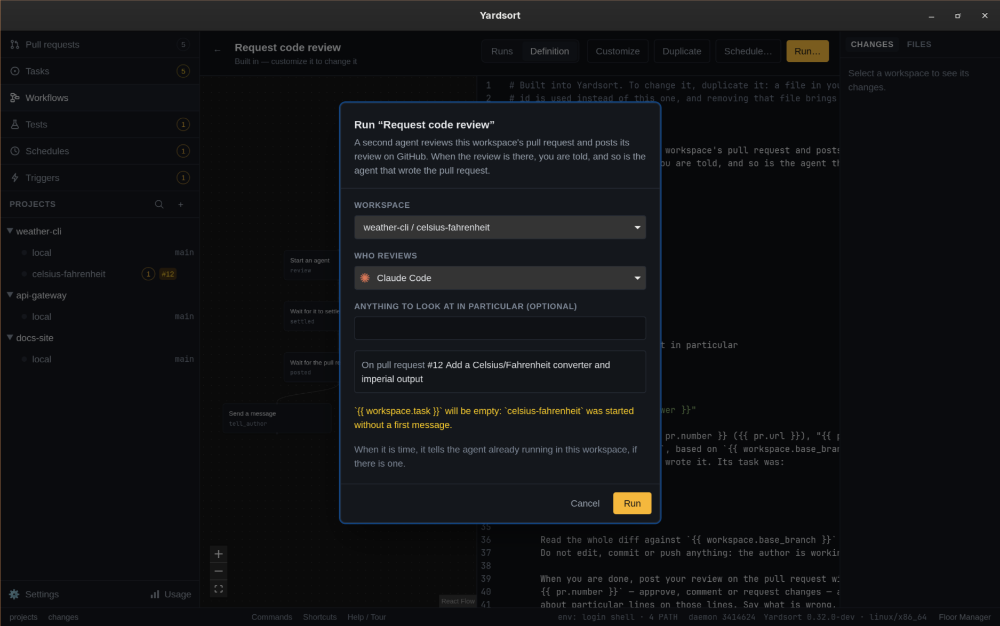
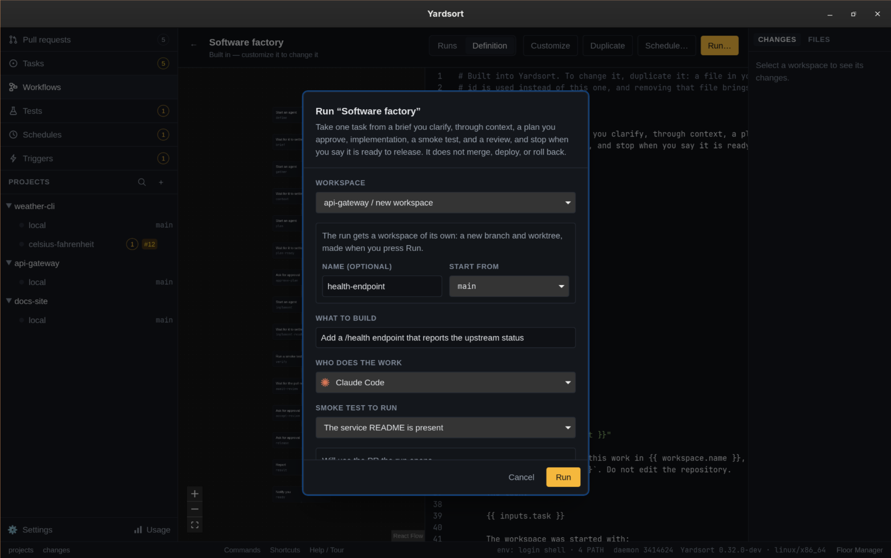

# Workflows

A workflow is a named, reusable piece of agent work that runs in steps. For example: have a second
agent review this workspace's pull request, then tell me and the agent that wrote it. You write
one as a short YAML file. Yardsort checks every name and every `{{ variable }}` in it before it
runs anything, and names the line and column of each mistake.

**Workflows** in the sidebar opens the list of every workflow. Open one to follow its runs, or to
see its steps as a chart beside its file and edit it; **Run…** starts it. `ys workflow run` starts one from a
terminal, with Yardsort open, because the app is what carries runs out.

## The Workflows list

Click **Workflows** in the sidebar, under **Tasks**, and the center panel lists every workflow:
the built-in ones and yours, by name, with the description under each. The row stays lit while
the list or one of its workflows is open; click it again from the list to close it. A number
beside it is how many runs are waiting on you.

Each row says where the workflow comes from:

- **Built in** — part of Yardsort. It cannot be changed or deleted, only customized or
  duplicated (see below).
- **Custom** — a file in your workflows folder.
- **Custom, replaces the built-in** — your copy of a built-in, under the same id, used instead of
  it.

A row also says how many of its runs are going now, how many problems its file has (a workflow
with problems cannot run), and shows an orange dot for unsaved changes. The header counts how many
are built in and how many are custom. Runs waiting on you are listed above the workflows; click
one to open that run in its workflow.

Click a row to open the workflow. **←** in its header comes back to the list. **New workflow…**
starts a new one.

**Delete…** on a custom row deletes that workflow's file, after asking; the file is gone for
good. A copy that replaces a built-in has **Reset…** instead, which deletes your copy and brings
the built-in back. Built-in rows have neither.



A workflow's page has two views, switched in its header: **Runs** and **Definition**. It opens
on **Runs** when the newest run failed or is still going, or when you opened a run from
somewhere else, such as the list of runs waiting on you. Otherwise it opens on **Definition**.
A dot on **Runs** says the newest run failed (red) or is going (amber). **Schedule…** and
**Run…** are in the header in both views.

**Definition** is the workflow itself, side by side:

- **The chart**, on the left. Every step as a box, top to bottom, with an arrow from each step to
  the ones that need it. Steps that need the same ones sit side by side. The chart is drawn from
  the file and follows it as you type. Click a box (or focus it and press **Enter** or **Space**)
  to select that step and scroll the YAML editor to its highlighted `id` line, including in
  read-only built-ins. Click the chart background to clear the selection. Each box shows how that
  step went in the run on screen in **Runs** — the newest, unless you picked another — while
  **Show how the run in … went**, above the chart, is ticked.
- **The file**, on the right. A YAML editor. Every pause in typing checks the file, and each
  problem is marked where it is and listed under the editor. A built-in is read-only:
  **Customize** copies it into your folder under the same id, so your copy is used instead of it,
  and **Duplicate** copies it under a new id, as a second workflow. Your own file has **Save**,
  **Revert** while there are unsaved changes, **Duplicate**, **Describe a change**, and **Delete**,
  or **Reset to built-in** for a copy that replaces one, which deletes your copy and brings the
  built-in back. Deleting asks first, and goes back to the list. Unsaved changes are kept while
  Yardsort is open, so you can look at another workflow and come back; they are gone when it
  quits. **Save** and **Revert** are in the header in **Runs** too while there are unsaved
  changes.

**Runs** is three columns:

- **The runs**, newest first, with each one's state, how long ago it was asked for, the
  workspace, and whether a schedule or a trigger started it. The newest is on screen until you
  pick another.
- **The run.** Its workspace, when it was asked for, when it ended and how long it took, and the
  pull request it is about. When it failed, the reason is at the top, with **Continue from the
  failed step** right under it: see [Continuing a failed run](#continuing-a-failed-run). A run
  still going has **Cancel run**. **Copy id** copies the run's id, which every `ys workflow`
  command takes. Below that are **Summary** and the run's steps, each with how it went. On a run
  of more than six steps, three or more succeeded steps in a row fold into one row, such as
  **9 steps succeeded**; click it to list them all.
- **The detail**, across the rest of the window: the run's summary, or the step you picked. A
  run opens on the step waiting for you, else on the step that failed, else on its summary. The
  summary has the workflow, the workspace, where the run was asked from, its times, how many steps
  ended each way, its id, the pull requests it opened, and the inputs it was given. See
  [What a run opened](#what-a-run-opened). A step has its times, its note — what it
  did, or why it failed or was skipped — the approval or the question it is waiting on, the
  decision made on it, and each artifact it left, formatted when it is Markdown.

**Run…** opens a dialog. It asks for the workspace and for each of the workflow's inputs; an agent
is picked from the same list as the composer's, with those not installed greyed out. The
workspace is one that is already there, or **new workspace** under a project's name, which makes
one for the run: see [In a new workspace](#in-a-new-workspace). If the
workflow works with the pull request, the dialog looks it up and shows it, or says why there is
none to use. It also says what the run would find nothing for: a prompt that uses
`{{ workspace.task }}` in a workspace started without a first message, `{{ memory }}` in a
project that does not share it (it is also empty, without a note, while nothing is approved), or `{{ workspace.base_branch }}` on the default branch, which is
based on nothing. Those are notes, not refusals; the line renders empty. The run starts when you
press **Run**, and appears at the top of the runs at once.



A workspace's menu has **Run workflow…**, which opens the same dialog for that workspace, and
**Request code review…**, which opens it on the built-in review. A project's menu has **Run
workflow…** too: the dialog opens on a new workspace in that project, and still offers the
workspaces that are there.

**New workflow…** in the list starts a new workflow from a short example, with every part a file
needs.
Give it an `id` and **Save**: it is written as `<id>.yaml` in your folder, and never over a file
already there.

**Or describe it.** A new workflow has a box above the editor: say what it should do, in your own
words, and press **Write it**. The agent you already have writes it, in its non-interactive mode,
or your Anthropic API key does. Choose **Settings → Assist → Workflow writer** to use Claude
Code, Codex, or any installed, enabled harness with **Write args**, including a custom harness.
**Automatic** chooses the first installed writer; the optional Anthropic key is the fallback
when no agent can write or an agent fails. An explicitly selected writer that becomes unavailable
is reported: install or enable it, configure its Write args, or choose another writer. This
preference is saved across restarts and only applies to workflow files. The enable switch is
shared with
[having a commit message written](commits-and-pull-requests.md#have-it-written-for-you). The
model is told the file format and shown the built-in review as an example. What it writes is
checked like any file; when it has problems it is sent back once, with them, and whatever comes
back goes into the editor unsaved, with anything still wrong marked where it is. Nothing a model
wrote is a workflow until you save it. The agent runs in an empty repository of the profile's
own, never in one of your projects; a repository because some agents will not run outside one.

**Describe a change.** **Customize** on a built-in opens the same kind of box on your new copy,
headed **Describe a change**: say what should be different, in your own words, and press
**Change it**. Your own workflows have a **Describe a change** button that opens it, and closes it
again. The writer is the one chosen for new workflows, in **Settings → Assist → Workflow writer**.
It is shown the whole file as it is in the editor, unsaved changes included, and told to change
only what you asked and to keep the workflow's `id`. An answer with another `id` counts as a
problem and is sent back with the others, because a copy with another `id` would stop replacing
the built-in. If the second answer still has another `id`, it is set aside and the box says why;
nothing in the editor changes. What comes back is your unsaved text, with **Revert** to go back
and **Save** to keep it. If you type in the editor, save, or revert while it is being written, or
the file is changed outside the window (by the Floor Manager, say), the answer is set aside and
the box says so.

You can also ask the [Floor Manager](floor-manager.md#changing-a-workflow) to change a workflow.

## Where workflows come from

- **Built in.** Yardsort ships with eight. **Request code review** (`code-review`): a second
  agent, one you pick, reviews the workspace's pull request in the same worktree and posts its
  review on GitHub with `gh`. When the review is on the pull request, you get a notification, and
  the agent that wrote the pull request is told once it is not busy. See
  [Requesting a code review](#requesting-a-code-review). **Request code review elsewhere**
  (`code-review-elsewhere`) does the same for a pull request the workspace
  [tracks in another repository](commits-and-pull-requests.md#pull-requests-in-other-repositories),
  and is started from that pull request, from **Request code review** on a workspace with no open
  pull request of its own, or by a trigger: see
  [A pull request in another repository](#a-pull-request-in-another-repository).
  **Smoke test, then tell the agent**
  (`smoke-then-tell`): it runs one of the workspace's [smoke tests](smoke-tests.md) and tells the
  workspace's own agent how it went — the verdict, and if it failed, which step broke. Three more
  are made for [triggers](triggers.md#ready-made-triggers), and can be run by hand too:
  **Address reviews** (`address-review`) tells the workspace's agent, once it is quiet, that its
  pull request has new reviews or comments, with the `gh` commands that read them, and asks it to
  fix what is right, push and answer each comment; **Fix failing checks** (`fix-checks`) tells it
  which checks failed on which commit and how to read their logs. Both last until the agent has
  answered. **Address reviews elsewhere** (`address-review-elsewhere`) does what **Address
  reviews** does for a pull request the workspace tracks in another repository, telling the agent
  that opened it, and is for a [trigger](triggers.md#pull-requests-elsewhere) on those. **Review the branch** (`review-branch`): a second agent, one you pick, reviews the
  branch against its base in the same worktree, without a pull request, and writes its findings
  as its last message; then the workspace's own agent is told to read them with
  [`ys workspace context`](cli.md#ys-workspace-context-workspace) and address them. **Software
  factory** (`software-factory`) takes a task from a brief you clarify, through a plan you
  approve, implementation, a smoke test and a review, and stops when you say it is ready to
  release. See [The software factory](#the-software-factory). Each is
  read-only; `ys workflow show <id>` prints the whole file.
- **Yours.** Every `.yaml` or `.yml` file in the `workflows` folder of Yardsort's data directory.
  [Where Yardsort keeps things](troubleshooting.md#where-yardsort-keeps-things) says where that
  is on your system, and `ys workflow list` prints it.

A file with a built-in's `id` is used instead of that built-in. That is how you change one:

```sh
ys workflow copy code-review                       # your copy, used instead of the built-in
ys workflow copy code-review --as careful-review   # or a second workflow beside it
```

`copy` writes the file into your folder, prints where, and never overwrites a file that is
already there. Edit the copy, then check it with `ys workflow validate`. Delete the file and the
built-in comes back. If your copy has a mistake, it is listed with its problems and does not run.
The built-in does not quietly run in its place.

Use `copy` rather than redirecting `ys workflow show` into the folder. The shell creates the
empty file before `ys` runs, so `ys` finds that empty file under the built-in's id and prints
nothing useful. Windows PowerShell's `>` also writes UTF-16, which is not a workflow file.

If two of your files have the same `id`, the first by file name is used. The other is listed with
a problem saying which file it clashes with.

Workflows only come from your own folder, never from a project's repository. A workflow decides
what is sent to your agents. A repository you cloned should not get to decide that.

## An example

```yaml
id: fix-tests
name: Fix the failing tests
description: An agent runs the tests on this workspace's branch and fixes what fails.
version: 1

trigger:
  kind: manual

inputs:
  - id: fixer
    kind: harness
    label: Who fixes it
    required: true

steps:
  - id: fix
    action: start_session
    harness: "{{ inputs.fixer }}"
    prompt: |
      Run this project's tests on `{{ workspace.branch }}`. Fix what fails, and commit the fix.

      {{ memory }}

  - id: done
    action: wait_session
    needs: [fix]
    session: "{{ steps.fix.session }}"
    timeout: 1h

  - id: tell_me
    action: notify
    needs: [done]
    title: "{{ workspace.name }}: the tests are fixed"
```

Steps run as soon as every step in their `needs` has succeeded, so steps can run side by side.
`tell_me` waits for `done`, and `done` waits for `fix`. Two steps that both need `done` would run
together.

## Running a workflow

**Run…** on the workflow, or **Run workflow…** in a workspace's or a project's menu, asks the same
questions as the command line and starts the run. From a terminal, with Yardsort open, because the app is what
carries runs out in the background while you keep working:

```sh
ys workflow run fix-tests --workspace fix-login --input fixer=claude
```

**Schedule…**, beside **Run…**, runs the workflow at a set time or on a routine instead: see
[Schedules](schedules.md). A [trigger](triggers.md) runs it when something happens in a workspace —
an agent says it is done, a test fails — made in the **Triggers** view or with `ys trigger add`. A
trigger's workflow must give each `run_test` step a `timeout`. A workflow with a `run_test` step can
be scheduled only when that test can run with nobody there: no `manual` step, and a file you have
approved.

`--workspace` takes a workspace's name or id. Run it inside a workspace's folder, or in an
agent's terminal there, and it can be left out. Give each input as `--input id=value`. `ys`
checks everything before anything is queued:

- the workflow is ready to run
- the workspace is there and not archived
- every required input is given, there are no inputs the workflow does not ask for, a `choice` is
  one of its options, and an agent named by a `harness` input or a step is set up in Yardsort and
  on your `PATH`
- a workflow that names `{{ pr.* }}` before any `wait_pr_activity` has an open pull request to
  use: the branch the workspace has checked out has one on GitHub, found with the GitHub CLI
  (`gh`), which must be installed and logged in. Its number, link and title are kept with the
  run. A workflow whose `{{ pr.* }}` steps all come after a `wait_pr_activity` can start before
  that pull request exists; the run looks again. `gh` not answering refuses either. A workflow
  about a pull request elsewhere still needs that pull request.

Optional inputs left out take their `default`, or are empty. A workflow runs once at a time in a
workspace: asking again while it runs is refused, naming the run. With Yardsort closed, `ys` says
so and queues nothing. When the run would find nothing for a variable the file uses — the task
of a workspace started without a first message, say — `ys` says so in a note after queuing, and
the Run dialog shows it before; the run goes ahead either way.

### In a new workspace

A run does not need a workspace to be there first. Started from a project, it gets one of its
own: a new branch and its worktree, made as the composer makes one, with the project's
[setup](projects.md#project-automation) run in it. This is for a workflow that does a whole piece
of work, such as **Software factory**, where the workspace is part of what the run makes.

In the Run dialog, choose **new workspace** under the project's name, or open the dialog from
**Run workflow…** in the project's menu. Two more fields appear:

- **Name**: what to call the workspace. Left empty, it is named after the workflow's id. Either
  way a number is added when the name is taken, so a second run of `software-factory` works in
  `software-factory-2`.
- **Start from**: the branch the new one is made from. It starts on the repository's default
  branch.

From a terminal, `--project` takes the place of `--workspace`, with `--name` and `--base` for the
same two things:

```sh
ys workflow run software-factory --project app \
  --input task="Add a logout button" --input agent=claude --input suite=login
ys workflow run fix-tests --project app --name nightly-fix --base release --input fixer=claude
```

It prints the workspace it made, with its branch and folder, and then the run.



Everything is checked before the workspace is made, so a run that is refused leaves no branch
and no folder behind. Three things are different from a run in a workspace that was there:

- A workflow that needs an open pull request when it starts is refused, because a branch made
  now has none. **Request code review** is one. A workflow that waits for its pull request
  starts, as it does anywhere.
- `{{ workspace.task }}` is empty for the whole run, since the workspace was started with no
  first message. The dialog and `ys` say so.
- No agent is working there yet, so a step for `session: origin` is skipped, saying so.

A `test` input offers the smoke tests of the project's own checkout, because the new workspace
is not there to look in. A test that is not on the branch the workspace starts from fails its
step when the run reaches it.

If the project's setup command fails, the workspace is kept, as it is when the composer makes
one, and no run is queued. The message says where the workspace is. A workflow about a pull
request elsewhere is started from that pull request, never in a new workspace.
A [schedule](schedules.md#a-new-workspace-for-each-run) can make a workspace for each of its
runs the same way. [Triggers](triggers.md) still name a workspace that is there.

### Following a run

`ys workflow run` prints the run's id and returns at once. The app picks the run up within a
second, and moves each step on as soon as it can: every second, and the moment an agent goes
quiet or ends. To follow it:

```sh
ys workflow runs                  # every run, newest first
ys workflow runs --run 3f2a9c1e   # one run, its steps, artifacts, and any approval
ys workflow approve 3f2a9c1e sign-off --code <code> --feedback "ship it"
ys workflow reject 3f2a9c1e sign-off --code <code>
ys workflow request-changes 3f2a9c1e sign-off --code <code> --feedback "split the migration"
ys workflow cancel 3f2a9c1e       # stop it
ys workflow continue 3f2a9c1e     # take a failed run up again from the step that failed
```

What each step does while it runs:

- **`start_session`** starts the agent as the composer would — except that its first message
  gets the project's approved memory without the request to propose more — and it opens as a new
  tab in that workspace. The tab you were looking at stays in front. From then on it is an ordinary
  session: you can watch it, type to it, or close it.
- **`wait_session`** waits until the agent has **settled**: it has gone quiet after at least 8
  seconds of output, or its harness reported that it finished its turn. With `until: exited` it
  waits for the program to end. An agent that ends while it is waited on ends the wait too.
- **`send_to_session`** waits until the agent is quiet, then types the message and presses Enter.
  It looks again at the moment of typing, and never types into a busy agent. If the agent ends
  first, the step is skipped. `session: origin` is the workspace's own agent: its newest agent
  session that was running when the run started. A shell is not an agent, and neither is an
  agent the run starts itself. With none running then, the step is skipped, saying so.
- **`wait_pr_activity`** waits for a review or a comment, as `kind` says, posted on the pull
  request after the run started. It asks GitHub every 30 seconds, in the background, so a slow
  answer holds up no other step; a question GitHub has not answered within a minute is dropped
  and asked again.
- **`run_test`** queues one of the workspace's [smoke tests](smoke-tests.md) and waits for its
  verdict. The run shows as a tab in the workspace, like any other. A test whose file you have
  not approved waits for you in Yardsort, and the step waits with it until its timeout. The step
  succeeds once the test reaches a verdict, whether it passed or failed, so a later step can
  read that verdict and act on either. It fails only when the run reaches no verdict
  (cancelled or errored) or does not end in time. With `gate: true`, a failed verdict fails
  the step, skips every other step that has not finished, and stops the run. It leaves the run's verdict and the summary
  `ys test wait` prints for later steps to use.
- **`notify`** shows a system notification.
- **`approve`** waits for you to approve, reject, or request changes. It is always a gate.
  Waiting for a GitHub review is not this. See [An approval](#an-approval).

A step runs only when every step in its `needs` succeeded. When one fails, the steps that need it
are skipped, and the run fails with that step's reason. A gate that fails also skips the steps
that do not need it. See [A test that must pass](#a-test-that-must-pass).

### What a run opened

A run that opens pull requests lists them, so you do not have to look for them on GitHub. They
are on the run's **Summary**, each with its state, **Open on GitHub**, and for one in the
project's own repository **Pull requests view**. The run's row in the list says how many, such
as **2 PRs**. `ys workflow runs` has a **PRS** column, and `ys workflow runs --run <id>` lists
each one under **Pull requests**; `--json` has them as `pullRequests`, with `repo`, `number`,
`url`, `title`, `state`, `draft` and `openedAt`.

A pull request counts as the run's when its workspace has it and it was opened while the run
was going — from two minutes before the run was asked for to fifteen minutes after it last
ended, so one an agent is still opening as the last step ends counts too. Nothing is read from
what an agent printed. Two kinds:

- **In the project's own repository**, opened on the workspace's branch. Yardsort notices these
  when it reads the project's pull requests, which it does about once a minute while it is open,
  and as its window comes into focus. A run's list can take up to a minute to show a new one.
  Its title and state follow GitHub's from then on. A pull request GitHub gives no opening time
  for is not counted.
- **In another repository**, one the workspace [tracks](commits-and-pull-requests.md#pull-requests-in-other-repositories) — opened in a nested
  clone, and tracked by the agent's hook, by `ys pr track`, or by **Track pull request…** — while
  the run was going. These are listed by repository and number, without a title or a state;
  the Pull requests view and `ys pr tracked` have those.

A run that is continued has one life, from when it was asked for to when it last ended: a pull
request opened between the failure and the continue is the run's too.

### A run's result

A `report` step says what the run came to. Its only job is to output text: a `body` in Markdown,
and an optional `title`. It notifies nobody. What every `report` step in the run said, in the
order of the file, is the run's **result**: it is the first thing on the run's **Summary**, and
`ys workflow runs --run <id>` prints it under **Result** before the steps (`reports` in `--json`).
On its own step in the run, a report shows what it said.

```yaml
- id: result
  needs: [release]
  action: report
  consumes: [brief]
  title: "{{ workspace.name }} is ready to release"
  body: |
    ## Pull requests

    {{ run.pull_requests }}

    Merging and deploying are still yours to do.
```

The body takes every [variable](#variables), including `{{ run.pull_requests }}`. A report
saves its words once, so one that places `{{ run.pull_requests }}` first asks GitHub about the
workspace's branch itself instead of relying on the app's once-a-minute look: a pull request
opened a moment before still makes the list. It waits for that answer, which takes a few seconds;
if GitHub cannot be reached, it lists what is already known. A report that
`consumes` an artifact and does not place `{{ artifacts.<name> }}` in its body has the artifact
added at the end, under **Artifact: <name>**, as a prompt does. A body is kept to 32000
characters. A `report` leaves `title` and `body` for later steps, so a `notify` after it can say
`{{ steps.result.title }}`. The built-in software factory ends with one.

### Continuing a failed run

A run that failed part of the way through does not have to start over. Open it in the
workflow's **Runs** and press **Continue from the failed step**, right under the run's
error, or:

```sh
ys workflow continue 3f2a9c1e
```

It is the same run, with the same inputs and the workflow file as it was when the run was
asked for, so an edit to the file since then does not change it. Every step that succeeded is
kept as it was: what it left for later steps, its artifacts, and the agent sessions it started.
The step that failed goes back to the start and runs again, and so do the steps that were
skipped because of it. The run is _running_ again within a second.

A step that runs again is a new attempt, and nothing of the earlier one stands:

- A smoke test is queued again. If the earlier one never ended, which is what a `run_test`
  timeout means, it is cancelled first.
- An approval that was rejected, or that timed out, waits for you again with a new code.
- A clarifying step waits again for the agent's summary. A question the agent had already
  asked is no longer waiting in Yardsort: answer it in the agent's terminal, or tell the agent
  to ask again.
- A timeout counts from when the step starts again.
- A step that failed with _Yardsort stopped while this step was running_ is carried out
  again. Yardsort could not tell then whether the agent had started or the message had been
  typed, and it still cannot: look at the workspace's tabs first, so an agent is not started
  twice.

Later steps still talk to the sessions the earlier steps started. An agent that has ended
since is treated as it would have been during the run: a `send_to_session` to it is skipped,
and a `wait_session` on it ends at once.

Only a failed run can be continued, not a cancelled one or one that succeeded. It is refused,
and nothing changes, while the same workflow is queued or running in that workspace, when the
workspace is archived or gone, and from `ys` while Yardsort is closed. A step that reached
its `max_attempts` keeps that count, so one more failure there stops the run again. A run a
schedule started is treated as yours once you continue it: a smoke test that needs your
approval waits for you, where it failed at once before.

### A test that must pass

A `run_test` step with `gate: true` stops the whole run when the smoke test's verdict is a
failure. Every step that has not finished is skipped, including one that does not list the
gate in `needs` and one that is still waiting, so a long wait does not keep the run open.
A step that lists the gate in `needs` says the gate did not succeed. One that does not says
the gate failed. A smoke test another step was waiting on is cancelled, so it does not keep
running or keep asking to be approved.

The run's error is a short line. It names the step and then the first line of the report,
such as failed login (2 of 6 steps passed). The step's note is the full report `ys test wait`
prints. You see both on the run in the app and in `ys workflow runs --run <id>`.
`ys workflow runs --run <id> --json` includes the report on the step and its outcome. A
schedule or a trigger that tells you when a run fails sends that short line. When the reason
is more than one line, or was cut short, it also says to open Yardsort for the report. A
`notify` step that needs the test does not run, because its message was written for a pass.

A run you start by hand, with no schedule and no trigger, does not send a system notification
on its own. The failure is on the run, and in `ys workflow runs --run <id>`.

Without `gate`, a failed test still lets the workflow continue, which is how **Smoke test,
then tell the agent** reports a failure for the agent to repair.

```yaml
id: check
name: Check
version: 1
trigger:
  kind: manual
steps:
  - id: smoke
    action: run_test
    test: login
    gate: true
    timeout: 30m
  - id: tell
    action: notify
    needs: [smoke]
    title: Tests passed
```

A file written before `gate` existed still loads. Leaving it out, or writing `gate: false`,
keeps the old behaviour.

### An approval

An `approve` step waits for you. Put it after a brief, a plan or a review, or before a
release. It is a gate: the steps that need it do not start until you approve. A rejection
stops the run, the same way a failed test gate does, and it is not an approval. Waiting
for a GitHub review (`wait_pr_activity`) is not this. That is a comment on a pull request,
not a decision you make here.

The run shows the artifacts the step consumes, so you can read the plan or the review
before you decide. The waiting step names them and has a **Review and decide** button
(**Review plan and decide** when there is one document, named plan). It opens a dialog almost
the size of the window. The document fills most of it, with tabs when there is more than one. A
`.md` file, or text with a Markdown heading, is shown formatted, and **Show plain text** shows
the text as it was written. The step's own words, the note and the decisions are beside it.
**Close** keeps the note you wrote, and the step then says the note is not sent.
A gate that reads no documents, such as a release sign-off, has **Approve** and **Reject** right
on the step, which decide at once and send a note you left in the dialog. **Add a note…** opens
the dialog, which is where **Request changes** is.
You approve, reject, or request changes, and you can leave a note.
Requesting changes needs a note. With no `on` routes, a request for changes stops the
run. The note is kept as an artifact named `changes-<step id>`, source `decision`, for
a later revision to read. [Conditional paths](#conditional-paths) can send that note
back to an earlier step. The step also
leaves `decision` and `feedback` for a later step to read as
`{{ steps.<id>.decision }}` and `{{ steps.<id>.feedback }}`.

You decide in the app, which needs no code, or from a terminal Yardsort did not start.
Leave `--code` out and `ys` asks at the terminal without echoing the code. That prompt
needs a real console. On Windows that is cmd, PowerShell, or Windows Terminal. Git Bash
and mintty have no console for it: pass `--code -` and pipe the code in. With no
terminal at all, `ys` fails at once and says to do that, instead of waiting. `--code -`
reads one line from standard input. Passing the code as `--code <code>` still works,
and `ys` warns, because that form stays in your shell history and in the process list.
The code is about eight characters. Yardsort shows it on the run. The notification
includes it unless Settings → General leaves it out, which is the default on Linux.
The notice then says to open Yardsort for the code. That is the notification on this computer.
A phone signed in through [Remote](remote.md#notifications) gets a separate notice that an
approval is waiting. It opens the decision and does not include the code. You can approve on
this computer, or on that phone while this computer is online. The phone sends the attempt it
was showing. A later pass is refused, and that tap does not use up a wrong code. Refresh the
run and decide again.
`ys workflow runs` does not print
the code, and neither does `--json`. A wrong code is refused. After five wrong codes,
`ys` stops until you press **Show a new code** in the window. Opening Yardsort again
does not clear those wrong tries. Listing the run does not issue a code. Opening
Yardsort replaces a code that was only in memory, and sends
a new notification, unless the schedule or trigger says `never`. Yardsort does not
have to be open for a correct code to be recorded. The run applies it once the next
time it is open, and does not apply it again.

```sh
ys workflow approve 3f2a9c1e sign-off --feedback "ship it"
ys workflow reject 3f2a9c1e sign-off
ys workflow request-changes 3f2a9c1e sign-off --feedback "split the migration"
```

Each of those asks for the code. To pass it without a prompt:

```sh
ys workflow approve 3f2a9c1e sign-off --code - --feedback "ship it"
```

and type the code on standard input. The code is the one Yardsort showed you. It is
not printed by `ys workflow runs`.

A session Yardsort started cannot decide, even if it drops `YARDSORT_COORDINATOR`.
`ys` refuses when any of `YARDSORT_COORDINATOR`, `YARDSORT_RUN_ID`,
`YARDSORT_WORKSPACE_ID` or `YARDSORT_SESSION_RECORD_ID` is set. The Floor Manager is
refused at every permission as well. This is not a sandbox. A process running as you
that writes the database directly is not stopped.

A decision is recorded once. A second one is refused, and so is one on a run that has
already ended. The run says `Blocked: waiting for your approval.` and what to do.
The Workflows list shows every run waiting on you, and the sidebar counts them. `ys workflow runs` has a WAITING ON
column. `ys workflow runs --run <id>` shows a step that is still waiting and the
artifacts it reads. It does not print a command that includes the code. It also
shows a decision once it is recorded: who, when, and the note. `--json` includes
`waitingOn`, `pendingApprovals` and `decisions`.

An artifact name that starts with `changes-` is reserved. The request writes
`changes-<step id>` itself.

A schedule or a trigger whose notify is not `never` tells you when a run starts waiting
for approval. So does a run you started yourself, and a schedule you started by hand.
`notify: never` does not.

`prompt` is optional, and can use variables. `timeout` is optional. Left out, the step
waits until you decide. A timeout fails that step, records no decision, and does not
stop a step that does not need it. `gate: false` is refused, because an approval is a
gate. Leaving `gate` out is the same as writing `gate: true`.

### Asking a question

An approval judges something the agent has already written. A clarification is earlier
than that: the agent does not know enough yet, so it asks, and the same session continues
with the answer.

```yaml
- id: discover
  needs: [draft]
  action: wait_session
  session: "{{ steps.draft.session }}"
  until: settled
  clarify: true
  max_rounds: 3
  produces:
    - name: brief
      from: brief
```

`clarify: true` is what makes the step able to wait for you. The agent asks with
`ys workflow ask --question "..."`, one `--question` for each question in the round.
Yardsort stores that round and the run waits. A question the agent only prints is not
asked. The step does not finish because the session went quiet. It finishes when the
agent records a summary, or when `until: exited` and the session has ended with no
question still open. With `until: settled`, a quiet session that is still running and
has no summary keeps waiting until `timeout`, and then the step fails. If that session
ends first, with no summary, the step fails and says the session ended without a
summary. The same happens when a question is still waiting for an answer. An answer
that was given and not yet typed fails because it could not be sent back.

You answer in the run view, which does not ask for a code, from a terminal Yardsort
did not start, or on a phone signed in to the same account while this computer is online.

In the run view the waiting step lists the round's questions and has an **Answer** button
(**Answer the question**, or **Answer 6 questions** when there are six). It opens a dialog that
shows one question at a time with room to answer it. **Next** moves on, and so does ⌘Enter
(Ctrl+Enter elsewhere). The numbers along the top jump to any question. You can leave a question
blank. After the last question, **Review** shows every question with its answer, and **Change**
goes back to one of them. **Send answers** sends the whole round as one answer, numbered in the
order the questions were asked, with `(no answer)` for a blank. It needs at least one answer.
A round with one question has no review: **Send answer** sends what you typed as it is.
**Close** keeps what you typed. The step then says how many are answered and not sent, and
**Continue answering** opens the dialog at the first blank question. A new round starts empty.

The terminal and the phone need the one-time code the window shows, the same way an approval does:

```sh
ys workflow answer 3f2a9c1e discover --text "30 seconds"
```

Leave `--code` out and type the code when asked, or pass `--code -` and the code on
standard input. The answer is typed back into the same session. If that session is busy,
nothing is typed and the next pass tries again. If Yardsort stops after it has claimed
the answer and before the typing is confirmed, the step fails and says the answer may
not have reached the session. It is not typed a second time. The agent can ask again, up
to `max_rounds` (3 when left out, 10 at most). One more than that fails the step. The run
says `Blocked: waiting for your answer.` and `ys workflow runs` shows `your answer` in
WAITING ON.

When the agent is finished it records the outcome with `ys workflow summary --text`.
That is refused while a question is still waiting for an answer. That text, with every
question and answer, is the `brief` artifact. A later step
`consumes` it like any other named artifact. The brief is not read out of the terminal.
A summary is what finishes the step when `until` is `settled`. If the agent records no
summary and the session ends because `until` is `exited`, the brief says so.

A session Yardsort started can ask and can record the summary. It cannot answer. That
stays with you. This is not an approval. The one-time code works the same way as one:
the window shows it, the notification on this computer includes it unless Settings → General
leaves it out, and `ys workflow runs` does not print it. A phone notice opens the question and
does not include the code. You can answer on this computer, or on the phone, as
[Remote](remote.md#notifications) describes. The phone sends the round it was showing. A later
round is refused, and that tap does not use up a wrong code. After five wrong codes the terminal
stops until you press **Show a new code**. The phone cannot be given a code until you do.

`timeout` still fails the step when you have not answered in time, or when a summary
never arrives. A schedule or a trigger whose notify is not `never` tells you a
question is waiting. `notify: never` stays quiet, and the code is still issued, so a
terminal can answer.

### Conditional paths

`on` sends a step to a different place depending on its outcome. It is only for `approve`
and `run_test`. The keys are the outcomes that step can produce, and each value is a
step id or `stop`. Yardsort does not branch on the text of a note or a report.

```yaml
- id: sign-off
  needs: [plan]
  action: approve
  prompt: Look at the plan.
  on:
    approved: implement
    changes_requested: plan
    rejected: stop
  max_attempts: 3
- id: verify
  needs: [implement]
  action: run_test
  test: "{{ inputs.check }}"
  gate: true
  on:
    passed: ship
    failed: implement
  max_attempts: 3
```

`approved` goes on to `implement`. `changes_requested` runs `plan` again and gives it the
note as `changes-sign-off`. `rejected` stops the run. A failed `verify` runs `implement`
again and gives it `failure-verify`, the report. A failed route that goes forward leaves
`failure-<step>` for the step it goes to. A pass goes on to `ship`. A pass that goes to
`stop` still ends the run when that step also `produces` an artifact: the run stops once
the artifact is saved.

Leave `on` out and the step behaves as before: a failed gate stops the run, and a success
lets every step that needs this one start.

An `approve` step must say where `approved`, `rejected` and `changes_requested` go. A
`run_test` step must say where `passed` and `failed` go. A target has to be a later step
that needs this one, or an earlier step this one needs, or `stop`. A step that no path
can reach is refused when the file is checked, and so is a loop with no `max_attempts`.

`max_attempts` counts every entry, including the first. It is at least 2 and at most 10.
The count is stored on the step. An inner loop's `max_attempts` counts entries across
outer loops, because the count is never reset. Quitting and opening Yardsort again does
not add one and does not start the count over. When the limit is reached the run stops, names the
outcome and the limit, and says to start a new run. You see that on the run in the app
and in `ys workflow runs`.

Sending the work back does not reuse an approval. Each pass waits again, shows a new
one-time code, and needs a new decision. A session Yardsort started still cannot decide,
and neither can the Floor Manager. The note or the failed report is an artifact the
step being run again can `consumes`. Each attempt is kept. A later attempt does not
overwrite an earlier one. The step reads the latest.

`stop` on a failure stops the run. `stop` on a pass ends the run successfully and skips
steps that have not finished.

A file written before `on` existed still loads.

A file written before approvals existed still loads. A run that was queued before this
change has no approval step, and it keeps running as it did.

**Cancelling** stops the run. Agents it started keep running as ordinary sessions: close them as
you would any other.

**If Yardsort quits during a run,** the run carries on when you open it again. A step that was
waiting keeps waiting, and a gate is not approved or skipped. A decision you recorded while it
was closed is applied once. A step Yardsort was in the middle of, such as starting an agent,
fails saying so rather than being done twice. A notification already sent is not sent again,
and an artifact already written is not written again. A request for changes writes its
artifact in the same change as the decision, or in the same change as sending the work
back, so a restart does not write it later. A loop's attempt count is kept, and a
rewind that already happened is not applied again. The
one-time approval code is replaced, because it was only in memory, and you are told. Wrong
tries are kept: five of them stay locked until **Show a new code**. An agent that settled while Yardsort was
closed is only noticed if its harness reported the finished turn.

## Requesting a code review

The built-in **Request code review** has a second agent review a workspace's pull request, then
tells you and the agent that wrote it. With the workspace's branch pushed and a pull request open
on GitHub:

```sh
ys workflow run code-review --workspace fix-login --input reviewer=codex
```

Add `--input focus="…"` for anything to look at in particular. What happens:

1. The reviewer starts in the same worktree, as a new tab. It is told the pull request, the task
   the workspace was started with, and to read and run but not edit, since the author works in
   the same folder. It posts its review with `gh pr review`, putting findings on the lines they
   are about.
2. When the reviewer has settled and its review is on GitHub, you get a notification.
3. At the same time, the agent that wrote the pull request, if it is still running in the
   workspace, is told the review is there once it is quiet, with the link, and asked to address
   it, push, and answer each comment.

GitHub does not let the author of a pull request approve it or request changes. When the reviewer
posts as the same GitHub account as the author, as it does when both use your `gh` login, it is
told to post its review as comments.

To change the prompts or the timeouts, `ys workflow copy code-review` and edit your copy.

### A pull request in another repository

A pull request the workspace tracks in one of the project's nested clones has **Request code
review…** in its details in the [Pull requests view](pull-requests.md#pull-requests-in-other-repositories).
It runs **Request code review elsewhere** (`code-review-elsewhere`) on that pull request, read by
its link:

1. The reviewer starts in the workspace, as a new tab, told the pull request, its repository and
   where the project keeps the clone of it. It reads the diff with `gh pr diff <link>`, runs the
   checks in a worktree of the clone of its own — `git worktree add` and `gh pr checkout`
   there, removed afterwards — leaving the clone's own checkout as it is, and posts its review
   with `gh pr review <link>`.
2. When the review is on GitHub — asked about by its link — you get a notification.
3. The agent that opened the pull request is told, if Yardsort knows which conversation that was
   (it does when the pull request was seen being opened, or tracked from that conversation with
   `ys pr track`), else the one running in the workspace; it is asked to fix what is right in the
   clone, push, and answer each comment.

It needs the clone: without one in the project's folder, the dialog says so and does not start.

In a parent project the workspace's own pull request is often merged or missing while its work is
in the clones. Then **Request code review** started from the workspace says it has no open pull
request, and lists the open ones the workspace tracks elsewhere: pick one and the dialog switches
to **Request code review elsewhere** on it, keeping what you chose. **Address reviews** does the
same with **Address reviews elsewhere**, and so does a workflow of your own `<id>` when there is
an `<id>-elsewhere` about a pull request elsewhere. **Choose another pull request** goes back to
the list. A run started this way from a workflow's page opens the page of the one it ran.

On **Request code review elsewhere**'s own page in the Workflows view, **Run** and **Schedule…**
are turned off: it needs a pull request elsewhere to be about.
A [trigger](triggers.md#pull-requests-elsewhere) can start it — or **Address reviews
elsewhere**, or any workflow about one — on the `pr.*` events of each pull request the workspace
tracks: `pr.opened` to review each one an agent opens. A workflow of your own can be about a pull
request elsewhere too, with `context: tracked_pull_request`; `pr.repo` and `pr.clone` are refused
in any other.

## The software factory

**Software factory** (`software-factory`) is the built-in that runs one task through the phases
below. Open it in **Workflows** and the chart shows every step, top to bottom, with an arrow
back where a phase repeats. The file beside the chart is the workflow. It is read-only;
`ys workflow copy software-factory` is how you change a timeout or a limit.

The run starts from the task. It does not need an open pull request first: the steps that name
`{{ pr.* }}` come after the review wait, and that wait looks the pull request up. `gh` has to be
installed and logged in, because Yardsort asks it when you press **Run** and looks again while
the run is going. The smoke test you name has to be one of the workspace's.

With `--project app` in place of `--workspace`, or **new workspace** in the Run dialog, the run
makes the workspace it works in: see [In a new workspace](#in-a-new-workspace).

```sh
ys workflow run software-factory --workspace fix-login \
  --input task="Add a logout button" \
  --input agent=claude \
  --input suite=login
```

`task` is what to build. `agent` is who does the work, one of your agents. `suite` is the
[smoke test](smoke-tests.md) the verify phase runs. There is no input for how many times a
phase may repeat: that number is `max_attempts` in the file, 3 everywhere it loops, and it is
not a variable. Copy the workflow to change it. The range is 2 to 10.

What happens:

1. **Define the outcome** (`define`, then `brief`). An agent starts with your task and the
   workspace's. `brief` waits on that session with `clarify: true`. The agent asks with
   `ys workflow ask`, one `--question` per question, and you answer in the run view, from a
   terminal Yardsort did not start, or on a phone signed in to the same account while this
   computer is online. The window does not ask for a code. The terminal and the phone do, the
   same one-time code as an approval. A question only printed in the terminal is not asked.
   When the agent has enough, it records the brief with `ys workflow summary --text`. The
   prompt tells it to cover the problem, the behaviour you want, the constraints, and the
   acceptance criteria. The `brief` artifact is that summary together with the questions and
   the answers. The engine does not check that the four headings are present: it stores what
   the agent recorded. Up to 5 rounds. The step waits up to 24 hours, then fails. Going quiet
   does not finish it.
2. **Gather context** (`gather`, then `context`). A new agent reads the brief, inspects the
   code and the docs, and writes `factory/context.md`. It deletes that file first when one is
   already there, so a later pass is not the previous notes. It is told not to change product
   code and not to commit. `context` copies that file into the `context` artifact when the
   agent settles. The step fails if the file is not there. The wait is 2 hours.
3. **Plan** (`plan`, `plan-ready`, then `approve-plan`). An agent reads the brief and the
   context and writes `factory/plan.md`, deleting that file first when one is already there,
   so a plan sent back is not the previous file. It is told not to implement. Then an approval
   gate
   shows you the plan. **Approve** starts implementation. **Request changes** needs a note,
   runs planning again, and gives that note to the agent as `changes-approve-plan`. **Reject**
   stops the run. The gate can be entered 3 times, including the first. The third request for
   changes stops the run and says to start a new one. Each pass waits again, shows a new code,
   and needs a new decision. You decide in the app, from a terminal, or on the phone. The
   notification on this computer includes the code unless Settings → General leaves it out.
   The phone notice does not include the code. It opens the decision.
4. **Implement** (`implement`, then `implement-ready`). An agent works from the approved plan,
   commits, and pushes to `{{ workspace.branch }}`. If that branch has no open pull request,
   it opens a draft with `gh pr create --draft`. If one is already open, it updates that one
   and does not open a second. `factory/` is a note for the run. Yardsort writes
   `factory/.gitignore` in that worktree, so the notes stay out of commits there and not in
   every other worktree of the repository, and the agent is told not to commit them. The wait
   is 4 hours.
5. **Verify** (`verify`). Runs the smoke test you named, with `gate: true`, and waits up to 30
   minutes. A pass goes on to review. A failure runs implementation again and gives it
   `failure-verify`, the report. A file you have not approved waits for you, and the step
   waits with it. The enforced verdict is that smoke test. There is no step that runs an
   arbitrary project command such as `cargo test`; the implement agent can run those itself,
   and this phase is the one Yardsort records. The step can run 3 times in the whole run,
   including the first. The count is not reset when review sends the work back, so a failure
   after a review uses one of the same three. The third failure stops the run.
6. **Review** (`await-review`, then `accept-review`). `await-review` waits until a review
   appears on the pull request, posted after this wait began. A review from an earlier pass
   does not count. While the branch still has no open pull request, the step keeps waiting;
   it does not fail. It has no timeout, and it keeps waiting if you quit and open Yardsort
   again. A comment that is not a review does not count.
   Then an approval gate. **Approve** goes on. **Request changes** needs a note, runs
   implementation again, and gives it `changes-accept-review`. **Reject** stops the run. The
   gate can be entered 3 times, including the first. The third request for changes stops the
   run. The wait sees that a review appeared. It does not read
   whether GitHub recorded an approval or a request for changes. That decision is yours, at
   this gate.

The run ends at **release**. The prompt says the work is ready to release. **Approve** finishes
the run: `result`, a [report](#a-runs-result), leaves the run's result — the pull requests it
opened and the brief agreed at the start — and then `ready` notifies you. **Reject**, or **Request
changes**, stops the run: this gate has no loop back. Nothing is merged, deployed, or rolled
back. A copy of the factory you made before this has no `result` step; **Describe a change**
can add one.

The chart's arrows back are the three loops: from the plan gate to planning, from the smoke
test to implementation, and from the review gate to implementation. A route to `stop` is not a
box.

What this workflow does not do:

- It does not open the pull request itself. Implementation is told to open a draft with
  `gh pr create --draft` when the branch has none, or to update the one already open.
  `await-review` follows that pull request once Yardsort can see it. Until then the wait
  continues. The run can start without one because the steps that name `{{ pr.* }}` come after
  that wait. A workflow that names the pull request earlier still needs one open first.
- It does not take the retry limits as inputs. Copy the file to change `max_attempts`.
- It does not branch on the text of a note, or on GitHub's own review state.
- It does not merge, deploy, or roll back.
- It does not record what happened and learn from it.

## The file

| Key           | What it is                                                                                                                                                                                                                            |
| ------------- | ------------------------------------------------------------------------------------------------------------------------------------------------------------------------------------------------------------------------------------- |
| `id`          | Lowercase letters, digits and `-`, like `fix-ci`. Name the file after it.                                                                                                                                                             |
| `name`        | What the workflow is called in lists.                                                                                                                                                                                                 |
| `description` | Optional. One or two sentences.                                                                                                                                                                                                       |
| `version`     | `1`. A file with a later version is listed but not run, and says to update Yardsort.                                                                                                                                                  |
| `trigger`     | `kind: manual`: you start it. Optional `context`: `workspace`, the default — a run is about one workspace — or `tracked_pull_request`, about a pull request a workspace tracks in another repository, started from that pull request. |
| `inputs`      | Optional. What you are asked before a run starts.                                                                                                                                                                                     |
| `steps`       | At least one.                                                                                                                                                                                                                         |

Keys a workflow does not have are mistakes, not ignored. A misspelt `promt:` is reported, not
silently skipped.

### Inputs

| Key        | What it is                                                                                                |
| ---------- | --------------------------------------------------------------------------------------------------------- |
| `id`       | Starts with a lowercase letter; then lowercase letters, digits, `_` and `-`. Used as `{{ inputs.<id> }}`. |
| `kind`     | `harness` (one of your agents), `test` (one of the workspace's smoke tests), `text`, or `choice`.         |
| `label`    | Optional. The question. The `id` when left out.                                                           |
| `required` | Optional. `false` when left out. An optional input left empty is empty text wherever it is used.          |
| `default`  | Optional. For a `choice`, one of its options.                                                             |
| `options`  | For a `choice` only: the answers to pick from.                                                            |

### Steps

Every step has an `id`, named the same way as an input, and an `action`. `needs` is optional: the
steps that must finish first. A step cannot need itself. Steps that wait for each other in a
circle are reported, because none of them could ever start.

| Action             | Keys                                                              | What it does                                                                                                                                                                                                                                                                                                                                                                                                                                                                                                                                                                                                                                                 |
| ------------------ | ----------------------------------------------------------------- | ------------------------------------------------------------------------------------------------------------------------------------------------------------------------------------------------------------------------------------------------------------------------------------------------------------------------------------------------------------------------------------------------------------------------------------------------------------------------------------------------------------------------------------------------------------------------------------------------------------------------------------------------------------ |
| `start_session`    | `harness` (required), `prompt`, `model`, `effort`, `skip_memory`  | Starts an agent in the workspace, like the composer does, with `prompt` as its first message. It opens as a tab there. `harness` is an agent's id, like `claude`, or exactly `{{ inputs.<id> }}` for an input of kind `harness`.                                                                                                                                                                                                                                                                                                                                                                                                                             |
| `wait_session`     | `session` (required), `until`, `timeout`, `clarify`, `max_rounds` | Waits for a session. `until: settled`, the default, means it has gone quiet after at least 8 seconds of output, or its harness reported a finished turn. `until: exited` means the program has ended. `clarify: true` lets the agent ask you questions. That step finishes when the agent records `ys workflow summary`, or when `until` is `exited` and the session has ended with no question still open. Going quiet does not finish it. A session that ends with no summary fails the step. A session that is still running and has no summary waits until `timeout` and then fails. `max_rounds` is how many rounds, from 1 to 10, and 3 when left out. |
| `send_to_session`  | `session` (required), `prompt` (required), `timeout`              | Types `prompt` into a running session. It waits until that session is quiet: a busy agent is never interrupted. If the session is gone, the step is skipped.                                                                                                                                                                                                                                                                                                                                                                                                                                                                                                 |
| `wait_pr_activity` | `kind`, `timeout`                                                 | Waits for a new review or comment on the workspace's pull request, since the run started. `kind` is `review`, `comment` or `any`, the default.                                                                                                                                                                                                                                                                                                                                                                                                                                                                                                               |
| `run_test`         | `test` (required), `inputs`, `timeout`, `gate`                    | Runs a smoke test in the workspace and waits for its verdict. The step succeeds whether the test passed or failed, so a later step can read `verdict` and act on either; it fails only on no verdict or a timeout. `gate: true` makes a failed verdict fail the step, skip the steps still going, and stop the run. `test` is a test id, or exactly `{{ inputs.<id> }}` for an input of kind `test`. `inputs` is a map of the test's own input ids to values.                                                                                                                                                                                                |
| `notify`           | `title` (required), `body`                                        | Tells you, with a system notification.                                                                                                                                                                                                                                                                                                                                                                                                                                                                                                                                                                                                                       |
| `report`           | `body` (required), `title`                                        | Says what the run came to, as Markdown: the run's result. Its only job is to output that text. See [A run's result](#a-runs-result).                                                                                                                                                                                                                                                                                                                                                                                                                                                                                                                         |
| `approve`          | `prompt`, `timeout`, `gate`                                       | Waits for you to approve, reject, or request changes. Always a gate: a rejection or a request for changes stops the run. `prompt` is the question, and can use variables. `timeout`, when set, fails the step with no decision and does not stop a step that does not need it. `gate: false` is refused. Waiting for a GitHub review is `wait_pr_activity`, not this.                                                                                                                                                                                                                                                                                        |

A key that belongs to another action is reported as misplaced. `title` on a `start_session` step
is an example.

**`session`** is `origin`, meaning the agent already working in the workspace when the run started, or
`"{{ steps.<id>.session }}"` for a session an earlier `start_session` step started. That step
must be among this step's `needs`, directly or through another step.

**`timeout`** is a whole number and a unit: `30s`, `45m`, `2h`. At most a week. A step that runs
out of time fails.

### Variables

Any text in a step can use `{{ name }}`. Only these names exist. A name is a dotted path and
nothing else: no filters, no expressions. Anything else is reported where it is written.

| Variable                                                                                                                                                             | What it is                                                                                                                                                                                                                                                                                                                                                                                                                                                                                                                                                                                               |
| -------------------------------------------------------------------------------------------------------------------------------------------------------------------- | -------------------------------------------------------------------------------------------------------------------------------------------------------------------------------------------------------------------------------------------------------------------------------------------------------------------------------------------------------------------------------------------------------------------------------------------------------------------------------------------------------------------------------------------------------------------------------------------------------- |
| `project.name`, `project.root`                                                                                                                                       | The project, and the folder of its own checkout.                                                                                                                                                                                                                                                                                                                                                                                                                                                                                                                                                         |
| `workspace.name`, `workspace.branch`, `workspace.base_branch`, `workspace.path`, `workspace.task`                                                                    | The workspace the run is about. `task` is the first message it was started with; a workspace [made for the run](#in-a-new-workspace) has none. In the project's own checkout, `branch` is whatever git has checked out, and `base_branch` the repository's default branch, unless that is the branch itself.                                                                                                                                                                                                                                                                                             |
| `pr.number`, `pr.url`, `pr.title`, `pr.repo`, `pr.clone`                                                                                                             | The open pull request for the workspace's branch. Found when the run is queued when a step names it before any `wait_pr_activity`; that run needs one open. When every such step comes after a `wait_pr_activity`, the run can start without one and looks again, and a step that names it fails once that lookup finds there is still none. `wait_pr_activity` keeps waiting instead. For a `tracked_pull_request` workflow, the one it is about, read by its link, with `pr.repo` its repository (`owner/name`) and `pr.clone` the project's nested clone of it; both are empty for a workspace's own. |
| `inputs.<id>`                                                                                                                                                        | What was given for that input.                                                                                                                                                                                                                                                                                                                                                                                                                                                                                                                                                                           |
| `steps.<id>.<field>`                                                                                                                                                 | What an earlier step left: `session` and `run` from `start_session`, `outcome` from `wait_session`, `count` and `latest_url` from `wait_pr_activity`, `run`, `verdict` and `summary` from `run_test`, `decision` and `feedback` from `approve`, `title` and `body` from `report`. The step must be among this step's `needs`.                                                                                                                                                                                                                                                                            |
| `memory`                                                                                                                                                             | The project's [memory](memory.md): its approved entries, cited, when the project shares it and has any. Empty otherwise. It never carries the request to propose new entries that an agent you start yourself gets. An agent's first message gets the memory after it anyway; put `{{ memory }}` in a `start_session` prompt to have it there instead, not twice.                                                                                                                                                                                                                                        |
| `handoff`                                                                                                                                                            | The workspace's [handoff](terminals-and-sessions.md#handing-work-to-another-agent) packet: what happened there so far.                                                                                                                                                                                                                                                                                                                                                                                                                                                                                   |
| `artifacts.<name>`                                                                                                                                                   | Text of an artifact this step consumes. See [Artifacts](#artifacts).                                                                                                                                                                                                                                                                                                                                                                                                                                                                                                                                     |
| `run.id`, `run.pull_requests`                                                                                                                                        | The run itself: its id, and the pull requests it has opened so far, one line each as `#12 Title — link` or `owner/name#41 — link`, or a sentence saying there are none. See [What a run opened](#what-a-run-opened).                                                                                                                                                                                                                                                                                                                                                                                     |
| `event.kind`, `event.count`, `event.note`, `event.head`, `event.summary`, `event.verdict`, `event.url`, `event.number`, `event.title`, `event.authors`, `event.name` | What set off a run a [trigger](triggers.md#what-the-workflow-is-told) started. Empty in a run you started yourself.                                                                                                                                                                                                                                                                                                                                                                                                                                                                                      |

To write `{{` literally, for example in a prompt about a template language, write `\{{`.

### Artifacts

A step can hand a named document to a later step, so the next agent does not start from nothing.
`produces` lists what this step leaves when it succeeds. `consumes` lists what a later step is
given. The step that produces a name must be among its needs, directly or through other steps.

| Key       | What it is                                                                                                                                          |
| --------- | --------------------------------------------------------------------------------------------------------------------------------------------------- |
| `name`    | A lowercase name, like a step id: `spec`, `plan`, `report`.                                                                                         |
| `path`    | A file inside the workspace, read when the step succeeds.                                                                                           |
| `text`    | Text written here, with variables filled in.                                                                                                        |
| `field`   | One field this step already leaves, such as `summary`.                                                                                              |
| `from`    | `file`, `text`, `output`, `transcript` or `brief`. A transcript needs `from: transcript`. `brief` is only on a `wait_session` with `clarify: true`. |
| `session` | For a transcript. `origin`, or a session this workflow started.                                                                                     |
| `raw`     | For a transcript only. Keeps each turn's text. Otherwise the digest.                                                                                |

A `start_session` or `send_to_session` that consumes an artifact, and does not write
`{{ artifacts.<name> }}` in its own prompt, is given the text under a heading. A notification is
not. Put the variable in the title or the body if you want a short piece of it there.

Read a file on the step that finishes the work, usually the `wait_session`. A `start_session`
or `send_to_session` cannot hand on a file or a transcript: it succeeds before the agent has
written or replied. Text written in the step, and a field the step leaves, can still be handed
on. A `notify` step can hand on a file or a transcript that is already there when the notice
is sent. It does not wait for an agent to write one. A missing file fails the step.

Nothing secret is copied. A path that leaves the workspace is refused, and so is a link that
resolves outside it or onto a secret. A name that looks like a secret is refused too: `.env`
and `.envrc`, a key or a credential file, `.ssh`, `.git`, `.kube`, `.docker`, `secrets.*`,
and a `.tfvars` file. A name with a colon, or one that ends in a dot or a space, is refused.
Control characters in a body are dropped, except newlines and tabs, and so are
bidirectional controls, U+200B, U+2060 and U+FEFF. U+200C and U+200D stay, because
they are part of words in some languages. The text is cut at 32000
characters, and the stored copy says so. A transcript is copied only when the step says
`from: transcript`. It is the same digest Yardsort uses elsewhere, not the terminal
scrollback, and not tool output. `raw: true` keeps each turn's own text in full, still
without tool output, and it is still cut at 32000 characters.

The run keeps what was handed on. Open the run to read it, or use `ys workflow runs --run <id>`.
`--json` includes each artifact's name, step, source, body and which attempt wrote it.
A step that succeeds again replaces the latest copy. Each attempt is also kept, so a
revision does not overwrite the previous one. A failed attempt leaves the previous text,
and a later step reads the latest copy stored when it starts. A name starting with
`changes-` or `failure-` is reserved for the note a revision hands back. See
[Conditional paths](#conditional-paths).

A file written before this, and a run saved before it, still load. They simply have no artifacts.

## Checking a file

`ys workflow validate <file>` checks a file without needing Yardsort to have run on this machine.
It prints each problem as `file:line:column: message` and exits 1 if there are any:

```text
$ ys workflow validate fix-tests.yaml
fix-tests.yaml:20:36: `{{ workspace.brnch }}`: `workspace` has no `brnch`. It has `name`, `branch`, `base_branch`, `path`, `task`.
fix-tests.yaml:26:13: There is no step `fx`. Did you mean `fix`?
fix-tests.yaml:27:15: `{{ steps.fix.session }}` is used before step `fix` is sure to have run. Add `fix` to this step's `needs`.
```

That is the example above with `workspace.branch` misspelt and `needs: [fix]` written `[fx]`.

`-` reads the file from standard input. `--json` prints `{ valid, id, problems }`.

`ys workflow list` shows every workflow, whether it is ready to run, and where it comes from.
`ys workflow show <id>` prints the file that would be used, with any problems after it. See
[the `ys` command line](cli.md#ys-workflow).
